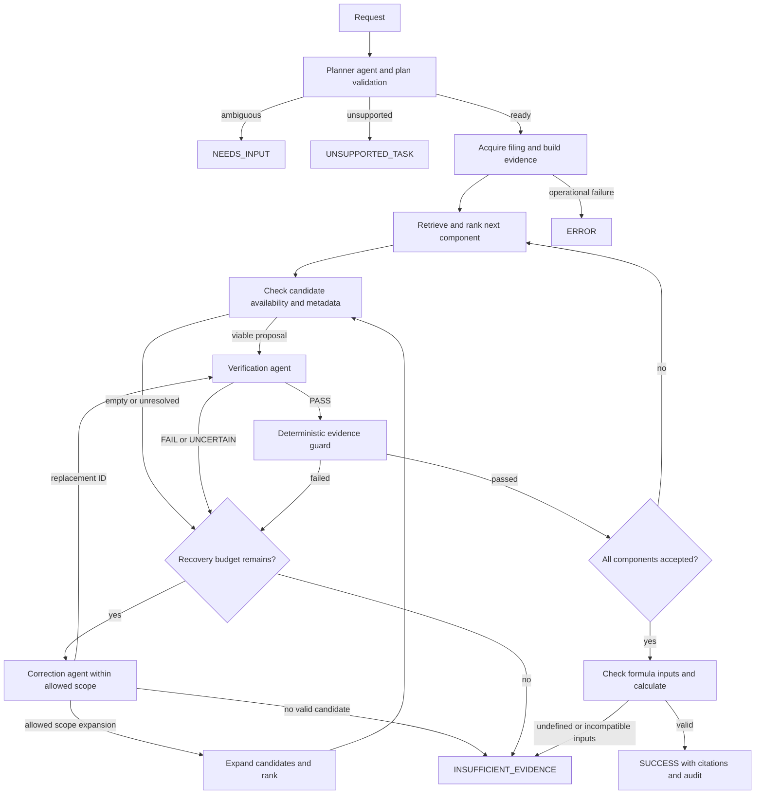

# Financial filing agent architecture and migration plan

## Recommendation and inspection scope

Build a bounded LangGraph application around the notebook's existing FinBERT retrieval, separate Qwen verification and recovery roles, and deterministic Python calculations. Add a model-driven planner, explicit evidence acceptance gates, and terminal abstention. Keep the notebook unchanged as the research record. This document is a design deliverable; application implementation has not begun.

Inspected the supplied 100-cell notebook `C:/Users/13466/fall2026/VIP2026/M4_InitialResults_multiagent1py1.ipynb`, its source and saved textual results, and `C:/Users/13466/Downloads/overview1.docx`. Cell references below are **zero-based JSON cell indices**, not execution counts. The pasted request mentions a `(2)` notebook variant; this plan uses the actual supplied file, not an assumed variant. The overview describes M3; the supplied notebook also contains the later Qwen extension, which takes precedence for implementation details. Neither notebook code nor model calls were executed during this inspection.

## What the prototype establishes

The notebook downloads Apple's FY2025 10-K, parses 54 HTML tables, selects operations table 14 and balance-sheet table 16, and constructs 62 evidence units including headers and nonnumeric rows. Three tasks require five component selections per condition. FinBERT uses `yiyanghkust/finbert-pretrain`, attention-mask mean pooling, L2 normalization, a default 256-token limit, and cosine ranking. Python alone computes the results.

Saved development results:

| Method | Clean evidence accuracy | Similar-item evidence accuracy | Broad-distractor evidence accuracy | Derived claims |
|---|---:|---:|---:|---|
| FinBERT baseline | 5/5 | 0/5 | 0/5 | 3/3 clean; 0/3 each stressed condition |
| FinBERT dual-view reranker | Not evaluated here | 1/5 | 0/5 | 0/3 each stressed condition |
| Exact-alias structured benchmark | Not evaluated here | 5/5 | 5/5 | 3/3 each stressed condition |
| Qwen verification and recovery | 5/5 | 5/5 | 5/5 | 9/9 across all conditions |

The Qwen extension's saved outputs report detection of 10/10 baseline errors, zero false passes among those ten errors, one false rejection among five correct selections, and top-5 recall of 14/15 components. Recovery can expand beyond top-5 to the **existing candidate pool**, not to the full filing. The final cell records `NameError: component_df is not defined` at execution count 1 after earlier results; saved outputs therefore do not establish clean-kernel reproducibility.

Preserve these results as observations, not performance guarantees. All use one development filing and three tasks. Candidate generation deliberately includes the gold row. Exact-alias verification has privileged development information. The later FinBERT safeguard was added after examining results. Qwen's separate roles share a model and are not statistically independent. Temperature zero does not ensure reproducibility across model/runtime versions.

## Architecture and responsibilities

An **agent** uses a model to make a decision. A **tool** performs deterministic computation or external work. **Shared state** records the task and evidence as the workflow progresses. The **orchestrator** enforces allowed transitions and budgets. A LangGraph node may invoke either an agent or a tool; a node is not automatically an agent.

| Layer or role | Responsibility and boundary |
|---|---|
| FinBERT model | Encode text with the notebook's exact pooling and normalization. It is a specialized retrieval model, not a planning agent. |
| Local decoder | One injected Ollama client serving planner, verifier, and corrector with separate prompts and schemas. Preserve direct HTTP initially; a LangChain wrapper is optional, not required. |
| Task Planner agent | Interpret a question into a supported formula, component concepts, periods, entity, statement requirements, and retrieval queries. New capability: the notebook uses static `TASKS`. It cannot invent formulas or silently resolve ambiguous entities/periods. |
| Evidence Verification agent | Audit a proposed row's accounting concept and formula role, using source context and period/unit metadata. Return `PASS`, `FAIL`, or `UNCERTAIN` with reasons. It does not calculate or choose replacements. |
| Correction/Recovery agent | Choose a replacement only from supplied evidence IDs, or request one allowed scope expansion, or return `NO_VALID_CANDIDATE`. It cannot fabricate rows, values, or arbitrary tool calls. |
| SEC acquisition tools | Fetch a specified filing or resolve an explicitly requested entity/filing; use configured identification, caching, bounded retries, and source hashes. |
| Parsing and evidence tools | Identify primary statements; retain table/row/cell provenance, hierarchy, periods, units, and raw text. Inline XBRL support is new work, not existing notebook functionality. |
| Retrieval tools | Generate candidates without gold annotations, rank with FinBERT, and optionally add separately evaluated lexical/concept/XBRL retrieval. Never equate rank with correctness. |
| Validation and calculation tools | Check source membership, statement, period, units, finite values, denominators, and accepted component coverage; apply an allowlisted formula deterministically. Mechanical checks do not prove semantic correctness. |
| LangGraph orchestrator | Route by validated outcomes, manage component iteration and bounded recovery, and prevent calculation from unresolved evidence. No autonomous ReAct loop. |
| Pipeline service | Assemble dependencies and graph, expose one request/result API to CLI and UI, and manage run lifecycle. |
| UI | Streamlit form for filing, question and periods; show answer or abstention, source rows, formula inputs, verification and recovery events. Keep model loading and workflow logic outside UI. |
| Configuration | Typed settings, versioned prompts and formula/concept registry. Separate runtime concepts from evaluator gold labels. |
| Audit and evaluation | Append run events and artifacts; evaluate completed runs externally with gold references never passed into production state or model payloads. |

Start with sequential component processing and an in-process graph. No vector database, agent messaging bus, distributed workers, or mandatory LangChain layer is justified by this workload. Cache evidence embeddings by source hash, parser version, encoder revision, text and tokenization settings.

## Shared state and data contracts

Use validated Pydantic records at external/model boundaries and a typed LangGraph state carrying serializable records and artifact references. Inject models, clients and settings through runtime context; do not put tensors, model instances, live DataFrames or HTTP sessions into persisted state.

Core records:

- `TaskPlan`: original request, entity/filing identity, formula ID, requested fiscal periods, required components, expected statement types and queries; status `READY`, `NEEDS_INPUT` or `UNSUPPORTED`.
- `EvidenceRow`: filing/accession and content hash, stable evidence ID, statement/table/row/source locator, raw cells/text, parent section, and explicit facts. Each fact has raw value, normalized value, unit/scale/currency, period start/end or instant, and XBRL context when available. Unknown metadata stays unknown.
- `ComponentState`: ranked IDs and scores, active search scope, proposed ID, verifier verdict and parse status, correction attempts, guard checks, accepted ID or null, and unresolved reason.
- `RunState`: run ID, schema/config/prompt/model versions, task plan, evidence artifact reference, component map, active component, recovery/transport budgets, terminal status, result reference and audit cursor.
- `CalculationResult`: formula ID, accepted source facts, intermediate values, value, unit and direction. Revenue growth is percent; margin change is percentage points; current-ratio change is ratio units.
- `FinalResult`: `SUCCESS`, `INSUFFICIENT_EVIDENCE`, `NEEDS_INPUT`, `UNSUPPORTED_TASK`, or `ERROR`; optional calculation, source citations, unresolved components and typed reasons. Errors such as Ollama unavailability are operational failures, not claims that the filing lacks evidence.

Production records have no `gold_aliases`, `is_gold_line_item`, correctness flags, expected numeric answer or evaluation tolerance. Evaluation joins references to completed audit artifacts outside the graph.

## State flow and abstention



All nodes record audit events. Exhausted transport or malformed-response retries route to `ERROR`; semantically unresolved evidence routes to `INSUFFICIENT_EVIDENCE`. These cross-cutting edges are omitted from the diagram for readability.

Acceptance requires a schema-valid verifier `PASS`, an actual supplied evidence ID, and successful deterministic checks for every requested fact. Corrected rows pass through verification and guards again. Any changed row or plan invalidates earlier acceptance. Calculation receives accepted facts only and checks all components again at its boundary.

Recovery starts with top-5, then the full current candidate set as in the notebook. A subsequent full-statement search is an explicit new scope, distinct from the notebook's expansion. Limit semantic recovery to two correction calls per component initially, with at most one scope expansion; chunk larger evidence pools without silently truncating them. Record scopes and budgets. Exhaustion never restores the rejected baseline as accepted evidence.

Similarity and top-1/top-2 margin are retrieval signals, not calibrated probabilities. Do not invent a universal cutoff. Use conservative structural and semantic acceptance now; calibrate optional score/margin policies on separate development/calibration data with absent-evidence examples, then freeze them before held-out evaluation. A confident Qwen verdict cannot override missing period/unit/provenance checks. Abstention means the workflow could not establish sufficient support in the searched scopes; it does not prove absence from the entire filing.

If one required component is unresolved, return no final derived number. The UI may still display verified rows and explain what is missing. Zero denominators produce an undefined-calculation reason, not a fabricated numeric result.

## Proposed repository

Use the existing workspace as repository root and a conventional importable package under `src`, avoiding a second generic `src` namespace inside another application directory. Paths below are proposed, not created application files.

```text
SEC_Agent/
  README.md
  ARCHITECTURE_AND_MIGRATION_PLAN.md
  pyproject.toml
  .env.example
  .gitignore
  app.py                              # thin Streamlit entry point
  src/financial_filing_agent/
    __init__.py
    cli.py
    config/{settings,prompts,financial_concepts}.py
    schemas/{state,evidence,results}.py
    models/{finbert,local_decoder}.py
    tools/{sec_client,filing_parser,evidence_builder,validation,calculator}.py
    tools/xbrl.py                     # later context-aware parsing increment
    agents/{planner,verifier,corrector}.py
    retrieval/{finbert_retriever,candidates,sufficiency}.py
    retrieval/hybrid_retriever.py      # optional separately evaluated increment
    graph/{workflow,routing}.py
    services/{pipeline,audit}.py
    ui/{streamlit_app,components}.py
  evaluation/
    fixtures/                         # source references, gold and snapshots
    {metrics,stress,benchmarks,runner}.py
  tests/
    {test_parsing,test_calculator,test_contracts,test_routing,test_abstention}.py
    test_notebook_parity.py
    integration/
  artifacts/                          # ignored caches and per-run outputs
```

Retain the original notebook at its supplied location; an optional immutable research copy can be added later with source hash and provenance. Avoid import-time downloads, output-directory creation, model loads, or graph execution. Initial dependencies: PyTorch, Transformers, NumPy, pandas, required HTML parser, requests, Pydantic/settings, LangGraph, Streamlit and pytest for development. Resolve compatible versions into a lockfile during implementation; do not infer application dependency pins solely from saved notebook versions.

## Migration mapping

| Notebook cells | Existing component | Destination and treatment |
|---|---|---|
| 2–11 | Device/model initialization; `finbert_embedding` | `models/finbert.py`; preserve tokenizer, masking, pooling, normalization and max length. Inject device and lazy lifecycle. |
| 12–13 | Synthetic ranking sanity check | Offline smoke fixture, outside research metrics. |
| 15–21 | SEC request, `pd.read_html`, `table_contains`, statement selection | `tools/sec_client.py`, `filing_parser.py`; preserve Apple fixture behavior, replace first-match generalization with explicit statement validation. |
| 23 | `clean_cell`, `compress_adjacent_duplicates`, `row_to_evidence` | `tools/evidence_builder.py`; preserve raw provenance and legacy representation for parity; add parent hierarchy and scoped IDs. |
| 24 | `normalize_label`, `parse_financial_numbers`, `first_two_values` | Legacy parser fixture plus `tools/validation.py` and context-aware parsing; do not use positional year assumptions generally. |
| 26, 80 | `TASKS`, `FORMULA_ROLES` | Split runtime formula/concept registry from `evaluation/fixtures`; new planner translates questions to this allowlist. |
| 28–32 | `DEV_SOURCE_REFERENCE`, `DEV_REFERENCE`, exact-match source checks | Evaluation fixtures and source-integrity regression checks only. |
| 34–36 | `generate_candidates`, `get_gold_row`, `row_has_two_values` | `evaluation/stress.py`; gold-inserting generator stays out of production. New `retrieval/candidates.py` handles actual available evidence. |
| 38–39 | `rank_candidates_with_finbert` | `retrieval/finbert_retriever.py`; preserve ranking math, handle empty pools, define stable tie policy and cache safely. |
| 40 | `calculate_task` | `tools/calculator.py`; preserve formulas/results, replace fixed-year extraction with explicit fact inputs and typed errors. |
| 42–43 | `component_is_correct`, `evaluate_task`, arithmetic preflight | `evaluation/metrics.py` and calculation tests; retain original metric definitions. |
| 44–60 | Baseline runner, exports, failure analysis, manifest | `evaluation/runner.py`, `services/audit.py`; preserve baseline traces and source/version information. |
| 52–58 | `structured_verify_component`, `verify_stressed_trace` | `evaluation/benchmarks.py`; label exact-alias mechanism as privileged diagnostic benchmark. It is a tool, not an LLM agent. |
| 62–69 | `finbert_assisted_verify_component`, dual-view runner and comparison | Evaluation benchmark retaining 0.45/0.45/0.05/0.05 weights, top-5 and normalization behavior; not the default production safeguard. |
| 74–78 | Ollama settings, `check_ollama`, `call_ollama_agent`, `extract_json_object` | `config/settings.py`, `models/local_decoder.py`; keep direct chat semantics; validate model availability and strict output schemas. |
| 79 | `evidence_for_decoder` | Explicit model-visible evidence schema; preserve exclusion of gold fields and add factual period/unit context. |
| 81–83 | Verifier prompt and `verify_finbert_selection` | `config/prompts.py`, `agents/verifier.py`; keep role and verdict semantics, remove hardcoded periods. |
| 84–86 | Reprocessor prompt, `call_reprocessor_once`, `reprocess_evidence` | `agents/corrector.py` plus graph routing; preserve supplied-ID checks and bounded expansion, remove rejected-baseline fallback. |
| 87 | `deterministic_evidence_guard` | `tools/validation.py`; preserve mechanical checks, strengthen context validation and make failures block acceptance. |
| 88–91 | Component/task multiagent runners | `graph/workflow.py`, `routing.py`, `services/pipeline.py`; move gold evaluation entirely outside execution. |
| 92–98 | Multiagent traces, verifier/repair metrics, summaries | Audit service and evaluation runner; retain false-pass/reject denominators, repair accuracy and top-k recall; replace dependence on global DataFrames. |
| Markdown cells | Method, results and caveats | README and evaluation protocol; preserve development-only status and information asymmetries. |

## Coupling and engineering risks

1. **Notebook state and side effects.** Global `model`, `tokenizer`, `device`, `evidence_df`, `TASKS`, references and output paths couple stages to execution order. Duplicate preview cells, `display`, console probes and directory writes belong in development utilities or entry points. The saved final error demonstrates state fragility.
2. **Apple-specific parsing.** First matching tables, labels, FY2025/FY2024 positions and the assumption that useful values exceed 100 do not generalize. `YEAR_TOKENS` may discard legitimate amounts; deduplication can erase equal values from different years. Preserve legacy behavior for parity only; read periods from headers/XBRL contexts, not number order. Parent sections distinguish repeated `Products`/`Services` labels. Equal year values must remain distinct facts.
3. **Units and context.** Current row payloads do not establish units, scale, currency or reporting context. XBRL adds context and dimensional ambiguity rather than eliminating it. Require consolidated-versus-segment and instant-versus-duration compatibility; surface unknowns rather than infer facts. No XBRL extraction is implemented in the supplied notebook.
4. **Unsafe acceptance paths.** Cell 86 can retain rejected evidence; cells 88–89 record guards without enforcing them. Replacements are not reverified. These are concrete reasons to change routing while preserving model roles and arithmetic.
5. **Model boundary validation.** Greedy JSON extraction, permissive defaults, unchecked confidence ranges and enum fields are insufficient. Prefer Ollama JSON-schema output plus application validation; validate verdict/decision consistency and supplied-ID membership. Preserve raw responses and distinguish parsing failures from genuine no-candidate decisions.
6. **Portability.** Apple is the filing issuer, not the execution platform: the inspected outputs show Windows, Python 3.11.13 and CPU PyTorch. No macOS/MPS-specific code was found. Windows paths, a named conda kernel, fixed directories, hardcoded contact identity and localhost configuration still require settings. Keep CPU as a supported default and CUDA optional.
7. **Reproducibility and correlated errors.** Pin encoder/tokenizer revisions and record the actual Ollama model digest rather than relying on mutable `latest`. Freeze prompts, candidate ordering, precision and tie behavior. Planner/verifier/corrector sharing Qwen does not provide independent assurance; measure role-specific failures and latency.
8. **Research contamination.** Gold-aware candidate generation is not production retrieval. Decoder payloads exclude gold labels, but current shared objects and traces still carry evaluation fields. Enforce distinct schemas and data paths. Frozen production concept mappings must be documented separately from task-specific evaluation aliases.
9. **Audit integrity.** Fixed filenames overwrite prior runs; `default=str` can hide schema problems. Use unique run directories, schema-valid JSON, source hashes and ordered events. Record timeouts, raw model responses, parsed decisions, scopes, guards, calculation inputs and terminal reasons. Treat filing text as untrusted data in model prompts; it must not change orchestration rules.

## Ordered implementation plan and acceptance criteria

1. **Freeze the research baseline.** Hash the supplied notebook and source filing, retain saved outputs as historical artifacts, and extract the Apple fixtures/reference protocol. Attempt a clean-kernel baseline separately when dependencies are available. Record any mismatch rather than editing the notebook or claiming saved results were reproduced.
2. **Create package and contracts.** Add settings, schemas, formula registry, dependency lock and injected clients. Validate missing SEC identity, model availability, unsupported plans and malformed payloads with clear typed outcomes.
3. **Extract deterministic tools.** Port acquisition, evidence construction, mechanical guard and calculations. Preserve legacy Apple parsing in the compatibility fixture; implement period/unit-aware parsing for application inputs. Check negatives, zero/small amounts, repeated year values, reordered columns, missing units, mixed contexts and zero denominators.
4. **Extract FinBERT faithfully.** Compare embedding norms, candidate IDs/ranking and scores within declared numeric tolerance against frozen fixtures. Do not change pooling or query wording while establishing parity. Test empty candidate pools and equal-score behavior.
5. **Extract Qwen roles and add planner.** Preserve verifier/reprocessor semantics; use validated structured results and allowlisted planner formulas. Test malformed JSON, unknown IDs, invalid enums/confidence, unreachable Ollama and actual no-candidate decisions. Use recorded/mock responses offline and a separately marked live integration run.
6. **Build the controlled graph.** Enforce gates, bounded correction, re-verification and terminal statuses. Essential routing tests: failed repair never calculates; guard failure blocks calculation; one missing component abstains; corrected evidence must be reaccepted; transport failure is `ERROR`; top-1 alone is never an acceptance signal.
7. **Add real retrieval and sufficiency policy.** Remove gold insertion from production. Evaluate missing-concept, missing-period, ambiguity and wrong-statement fixtures. Add scope expansion and optional lexical/XBRL retrieval as separately versioned increments, retaining FinBERT-only baseline comparisons.
8. **Expose CLI then Streamlit.** Both call the same pipeline. Display cited source facts, calculation units, verification/recovery status and abstention reasons; persist an audit artifact for each run. Smoke-test one supported Apple task and one deliberately absent-evidence request.
9. **Freeze and run evaluation.** Preserve original evidence accuracy, claim tolerance, direction and completion metrics and denominators. Add candidate recall, answer coverage, accuracy among answered tasks, unsupported-answer rate on unanswerable tasks, abstention on answerable tasks, operational failures, recovery cost and latency. Score abstention explicitly rather than automatically counting it as correctness. Keep original completion semantics separately labeled.
10. **Validate generalization.** Freeze configuration and calibration before held-out companies/concepts and report counts plus uncertainty. Keep Apple out of held-out claims. Compare baseline, FinBERT reranker, privileged alias benchmark and Qwen graph; separate planner/retrieval/extraction/verification/arithmetic failures. Ship runnable setup instructions and documented limitations only after these gates pass.

## Framework references

LangGraph's explicit shared state, nodes and conditional routing fit the bounded workflow described here; use `StateGraph` with typed state and conditional edges, without a general-purpose autonomous agent executor. See the [official LangGraph Graph API documentation source](https://github.com/langchain-ai/docs/blob/main/src/oss/langgraph/graph-api.mdx).

Ollama supports JSON-schema output through its `format` parameter. This can strengthen the existing HTTP adapter, with application-side validation still required. See the [official Ollama API documentation](https://github.com/ollama/ollama/blob/main/docs/api.md). Check the installed runtime's support during implementation.
