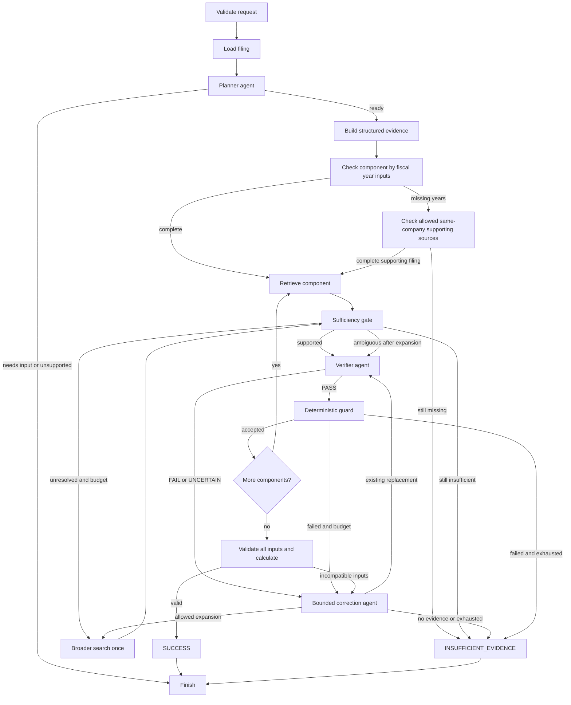

# Financial filing evidence agent

An executable local application for answering bounded financial questions from SEC financial statement evidence. FinBERT retrieves rows; Qwen plans, verifies and corrects evidence; Python performs the authoritative calculations. LangGraph controls every transition. Unresolved evidence produces an explicit non-answer rather than an unsupported number.

The original research notebook was not modified. Its Apple development results are historical observations, not claims about this application's held-out performance. See [the architecture and migration plan](ARCHITECTURE_AND_MIGRATION_PLAN.md) and [the implementation report](IMPLEMENTATION_REPORT.md).

## Start the application

Run from this repository in PowerShell. Python 3.11 is the tested interpreter; the package declares Python 3.11–3.13 support. Install [uv](https://docs.astral.sh/uv/) if it is not already available.

```powershell
uv venv --python 3.11 .venv
uv pip install --python .venv/Scripts/python.exe -r requirements-lock.txt
uv pip install --python .venv/Scripts/python.exe -e .
Copy-Item .env.example .env
# Edit .env and supply your own identifiable SEC contact before network acquisition.
.venv/Scripts/python.exe -m streamlit run app.py
```

The existing workspace `.venv` is already installed. To launch it now, only the last command is needed. The default artifact root is `artifacts/`, with separate filing, parsed-evidence, embedding and per-run audit directories. A local HTML file does not require an SEC contact setting.

The lockfile records the tested Windows CPU dependency environment. On another platform, resolve the compatible ranges in `pyproject.toml` with `uv pip install --python .venv/Scripts/python.exe -e '.[dev]'` and save that platform's resolved versions. The lockfile pins dependencies but is not a cryptographic supply-chain lock. No dependency downloads or model loads occur at module import.

## Ollama setup

Install [Ollama](https://ollama.com/), start its local service, and pull the decoder:

```powershell
ollama pull qwen2.5:latest
# Use ollama serve only if the desktop service is not already running.
.venv/Scripts/python.exe -m financial_filing_agent.cli --status
```

The default endpoint is `http://localhost:11434`, the model is `qwen2.5:latest`, and temperature is zero. Each role uses separate instructions and a validated JSON schema through the [Ollama chat API](https://docs.ollama.com/api/chat). Invalid JSON, invalid schema, exhausted transport retries, missing local files and failed SEC requests produce `ERROR`; they are not classified as missing financial evidence.

The application records the actual model digest where the tags API is available. `config/research.json` additionally enforces the Qwen digest observed during implementation and pins the encoder revision, CPU device, prompts/settings and budgets. A different Qwen download must be recorded as a new research configuration, not silently substituted. `latest` plus temperature zero alone does not guarantee repeatability.

## GPU and CPU

FinBERT supports `FFA_FINBERT_DEVICE=auto`, `cuda` or `cpu`. Auto uses CUDA when the installed PyTorch build and driver expose it; otherwise it uses CPU. Explicit CUDA requests fail clearly if CUDA is unavailable. Both the encoder and token tensors use the selected device. Candidate encodings are batched under `torch.inference_mode()` and model instances are cached per process/configuration. The notebook's masked mean pooling, L2 normalization and cosine semantics are preserved.

This workspace was also validated with `torch==2.7.1+cu128` on the available RTX 4060. For this Windows/Python 3.11 setup, after installing the CPU lockfile, the tested CUDA replacement command is:

```powershell
uv pip install --python .venv/Scripts/python.exe 'torch==2.7.1+cu128' --index-url https://download.pytorch.org/whl/cu128
.venv/Scripts/python.exe -c "import torch; print(torch.__version__, torch.cuda.is_available())"
```

For different hardware/drivers, use the [official PyTorch installation selector](https://pytorch.org/get-started/locally/). Qwen remains hosted by Ollama; the application does not allocate its tensors. The status endpoint reports resident model VRAM when `/api/ps` exposes it. VRAM allocation is a diagnostic, not proof that every decoder operation ran on GPU. Parsing, lexical matching, routing, guards and arithmetic remain CPU tasks. GPU availability is not required for correctness.

## CLI and demonstrations

```powershell
# Local retained Apple development filing
.venv/Scripts/python.exe -m financial_filing_agent.cli --source evaluation/fixtures/apple_2025_10k.html --question 'How did total net sales change from FY2024 to FY2025?'

# Network acquisition (configure your SEC contact first)
.venv/Scripts/python.exe -m financial_filing_agent.cli --source AAPL --question 'What was operating margin in FY2025?'

# An explicit accession is preferable for repeatable source selection
.venv/Scripts/python.exe -m financial_filing_agent.cli --source AAPL/0000320193-25-000079 --question 'How did the current ratio change from FY2024 to FY2025?'

# Enforce frozen research settings; --full includes serializable state
.venv/Scripts/python.exe -m financial_filing_agent.cli --config config/research.json --source evaluation/fixtures/apple_2025_10k.html --question 'How did total net sales change from FY2024 to FY2025?' --full

# Fast deterministic control-flow demonstration using clearly labeled test doubles
.venv/Scripts/python.exe -m evaluation.runner

# Real Qwen and FinBERT: success, controlled ranking error/recovery, absent periods
.venv/Scripts/python.exe -m evaluation.live_demo --scenario all
```

Sources may be a local HTML/cache path, uploaded HTML in the UI, a direct SEC HTTPS document URL, ticker, CIK, accession or `ticker/accession`. Ticker/CIK without accession intentionally resolves the latest available 10-K and records that selection; freeze an accession for research. Bare accessions are resolved using their prefix as a CIK and may fail for filing-agent accessions; provide `ticker/accession` in that case. Historic submission-file lookup is supported. Network requests identify the requester, are spaced, and use bounded retries. Filing bytes are cached and hashed; cache hits are checked against their stored content hash. See [SEC access guidance](https://www.sec.gov/search-filings/edgar-search-assistance/accessing-edgar-data).

Explicit fiscal periods are required. The UI's optional period field or CLI `--periods FY2025 FY2024` can supply them. Conflicting period inputs return `NEEDS_INPUT`. Missing entities/periods or ambiguous semantics must not be silently guessed. The selected filing supplies entity context to the model planner.

Supported formulas: revenue growth, operating margin, operating-margin change, current ratio, current-ratio change, gross margin, gross-margin change, R&D intensity (`rd_intensity`), inventory growth and accounts-receivable growth. Gross margin requires a gross-profit row; deriving an absent gross-profit row from revenue and cost is not currently implemented.

The metric menu constructs a deterministic formula/dependency plan and bypasses model planning. Supply the explicit fiscal years in the period field. A component-by-year input inventory is checked before retrieval/model verification; all components must subsequently pass verification and guards before the registered Python calculator runs once. The calculator returns each year's metric, absolute difference, relative percentage difference and direction. A zero previous metric makes relative percentage change undefined, without invalidating a defined absolute difference. Qwen never calculates or compares the numeric result.

**Qwen can be switched off** using **Enable Qwen agents** in the sidebar, `FFA_QWEN_ENABLED=false`, or CLI `--no-qwen`. This disables decoder planning, verification and correction calls. Select a registered metric and explicit years in this mode; free-text planning returns `NEEDS_INPUT`. FinBERT retrieval stays enabled. Evidence must satisfy deterministic registered concept, unit, statement, period and provenance checks; ambiguous evidence still abstains. The saved result records its mode and decoder-call count. Mode changes apply to subsequent runs.

Qwen review is now bounded by a per-request executable contract: only unresolved checks may be returned, each needs a source observation, and optional accounting certificates cannot become requirements. Invalid reviews get one contract-repair attempt and then an operational contract error, without triggering evidence expansion. The UI exposes the actual system prompts and run-specific contract/checks. See [Qwen responsibilities and verifier contract](QWEN_VERIFIER_CONTRACT.md).

Reported labels are interpreted with their value dimension. A monetary **Gross margin** subtotal may be the reported gross-profit amount; a percentage row cannot fill that component. Python additionally checks the same-table accounting identity `gross_profit = revenue - cost_of_sales` when unique compatible source rows exist. An exact certificate is recorded with all source IDs and period checks and directly validates the concept, even with Qwen enabled. This prevents a model's label-only reinterpretation from vetoing independently reconciled source evidence. Where no certificate is available, enabled Qwen receives the canonical definition, accepted reported labels and unit/context information. No derived replacement amount is invented by this certificate.

```powershell
.venv/Scripts/python.exe -m financial_filing_agent.cli --source evaluation/fixtures/converted_apple_2026_10k.html --formula gross_margin_change --periods FY2025 FY2024 --no-qwen
```

Balance sheets often report fewer years than income statements. In the supplied converted FY2026 Apple filing, revenue has FY2024 data but the balance sheet has only FY2026/FY2025. Therefore FY2024→FY2025 current-ratio change needs an older filing. Upload a supporting same-company filing, or explicitly enable the cached same-company search checkbox. The tool selects a single filing that covers the complete formula inputs, validates company identity, retains the original requested source in the audit, and discloses any source switch. It does not silently splice incompatible facts across filings. Example:

```powershell
.venv/Scripts/python.exe -m financial_filing_agent.cli --source evaluation/fixtures/converted_apple_2026_10k.html --formula current_ratio_change --periods FY2025 FY2024 --supporting-source evaluation/fixtures/apple_2025_10k.html
```

Without complete source periods, the pipeline identifies the missing component/year cells and abstains before expensive verification. An unrelated cash-flow row containing a matching year cannot satisfy a balance-sheet requirement.

## Responsibilities and graph

| Component | Responsibility |
|---|---|
| Task Planner agent | Qwen maps the question to an allowlisted formula, component queries, statements and explicit periods. |
| Evidence Verification agent | Qwen checks exact accounting meaning, source context, periods, units and formula role; returns PASS/FAIL/UNCERTAIN. |
| Correction/Recovery agent | Qwen selects an existing supplied evidence ID, requests the one allowed expansion, or reports no valid evidence. |
| FinBERT retrieval model | Encodes and ranks source rows; it is not an autonomous agent. |
| Tools | SEC/local loading, structured table/XBRL parsing, lexical signals, caches, guards, calculation and audit writes. |
| Shared state | A serializable typed record of task, source/hash, artifact references, candidates, decisions, accepted IDs, errors, budgets and timings. Models/tensors/sessions stay outside it. |
| LangGraph orchestrator | Explicit nodes/conditional edges enforce component iteration, retries, recovery, re-verification, acceptance and terminal outcomes. |
| UI and CLI | Collect requests and display the same pipeline result. Neither contains agent routing logic. |



Operational failures at any stage route to `ERROR`. No unconstrained ReAct loop is used. A maximum of two correction rounds and one expansion applies per component by default; correction candidate chunks and HTTP retries also have explicit limits. Every replacement is reverified and guarded. A rejected row is never restored as accepted evidence merely because recovery failed.

## Evidence and sufficiency policy

The parser preserves real statement rows and source/table/row/cell positions rather than flattening the entire filing into prose. Inline XBRL facts retain concepts, contexts, periods, scales, currency, dimensions, raw values and normalized values. Plain HTML uses explicit year/date header columns and currency/scale context. Converted HTML with dollar symbols can establish a monetary table basis without establishing an ISO currency code. For the registered dimensionless percentages/ratios, an unspecified currency can cancel only when all relevant facts share that table basis; no USD denomination is inferred from `$`. Mixed identified/unidentified currencies, conflicting currencies, unrelated source bases, genuinely missing units and ambiguous duplicate facts still fail validation. Equal values across years remain distinct. DOM table indices differ from the notebook's pandas table indices; source IDs include the filing hash.

Hybrid retrieval exposes FinBERT cosine, lexical similarity, exact normalized-label support, expected statement, XBRL concept support, period availability and numeric availability. Default fusion is `1.0*cosine + 0.25*lexical + 0.25*xbrl`. All signals and weights are recorded. These defaults are transparent heuristics, not calibrated confidence. Diagnostics include top scores, margin, method agreement and candidate availability.

The sufficiency gate returns `SUFFICIENT`, `UNCERTAIN` or `INSUFFICIENT`. Strong structural and concept support permits verification; it never directly authorizes arithmetic. Missing values/periods trigger broader search once and then abstention. Ambiguous concepts after expansion are assessed by the verifier. Only a validated PASS plus mechanical source, statement, period, unit, finite-value, context and denominator checks can accept a row. Final calculation rechecks complete accepted coverage, matching periods and currencies.

Output status is `SUCCESS`, `INSUFFICIENT_EVIDENCE`, `NEEDS_INPUT`, `UNSUPPORTED_TASK` or `ERROR`. Abstention means support was not established in the searched scopes; it does not prove that the entire filing lacks the evidence. Missing any required component suppresses the final derived number. No raw cosine score is interpreted as a probability.

Evidence embeddings are cached by filing hash, parser version, actual encoder revision, tokenizer/preprocessing, token limit and evidence-text hash. Subsequent questions reuse parsed evidence and cached row vectors, encoding only the query for unchanged rows. Broader search can introduce additional rows that have not yet been encoded.

## Audit and evaluation

Each request writes `artifacts/runs/<request_id>/audit.json` and an immutable-for-that-run evidence artifact. The audit includes config/hash, source/hash, timestamps, model names/revisions/digest where available, prompt/formula versions, graph transitions, structured decisions, model request/response content, guards, inputs, arithmetic, timings and counts. It does not request or retain a model's separate hidden thinking channel. Failed calls and partial runs are retained. The UI exposes concise reasons and expandable panels; the on-disk audit includes full model-call records.

The UI also displays live graph-stage starts and completions, including candidate counts, verification/guard outcomes and step durations. Windows audit replacement failures receive bounded retries; if the canonical filename remains locked, the result points to a complete `audit-recovery-*.json` snapshot. If no audit snapshot can be written, the run returns an explicit `ERROR` rather than a Python traceback or a financial answer. See [the runtime reliability fix](RUNTIME_RELIABILITY_FIX.md).

Runtime schemas contain no gold aliases, expected answers, correctness flags or tolerances. External evaluation joins those only after execution. `evaluation/fixtures/notebook_snapshot.json` freezes selected notebook source and saved observations, including its final clean-process error. Apple is development material only. The original study's conditional candidate recall and privileged alias benchmark caveats remain in the architecture plan and snapshot.

```powershell
.venv/Scripts/python.exe -m pytest -q --basetemp artifacts/test-temp

# Real encoder CPU parity plus CUDA when available; requires cached/downloadable weights
$env:FFA_RUN_LIVE='1'
$env:HF_HUB_OFFLINE='1'  # omit when weights must first be downloaded
.venv/Scripts/python.exe -m pytest tests/test_finbert.py -q --basetemp artifacts/live-test-temp
```

Tests cover contracts, all ten formulas, provenance, equal/zero/small/negative values, Apple calculation parity, missing periods/concepts, guard and repair failures, unknown evidence IDs, decoder/network errors, cache reuse/invalidation, fresh-process CLI/demo startup and Streamlit form submission. Live encoder tests compare batched output to the notebook's original single-text pooling and saved cosine scores; CUDA tests skip when unavailable. Scripted demonstrations test routing and do not estimate model accuracy.

## Repository tree

```text
SEC_Agent/
  app.py
  README.md
  IMPLEMENTATION_REPORT.md
  ARCHITECTURE_AND_MIGRATION_PLAN.md
  pyproject.toml
  requirements-lock.txt
  .env.example
  config/research.json
  src/financial_filing_agent/
    cli.py
    config/{settings,prompts,formulas,financial_concepts}.py
    schemas/{state,evidence,task,results}.py
    models/{finbert,local_decoder}.py
    tools/{sec_client,filing_loader,filing_parser,html,xbrl,evidence_builder,numeric_parser,validation,calculator}.py
    retrieval/{finbert_retriever,lexical_retriever,hybrid_retriever,sufficiency}.py
    agents/{planner,verifier,corrector}.py
    graph/{workflow,routing}.py
    services/{pipeline,audit,cache}.py
    ui/{streamlit_app,components}.py
  evaluation/
    fixtures/{apple_2025_10k.html,demo.html,notebook_snapshot.json}
    fixtures.py
    doubles.py
    metrics.py
    runner.py
    live_demo.py
  scripts/freeze_development.py
  tests/{test_application,test_finbert,test_ui}.py
  artifacts/  # ignored runtime/cache/test output
```

## Known limits

Table classification and runtime concept mappings are deliberately bounded; arbitrary SEC layouts, unusual Inline XBRL transformations, restatements, noncalendar fiscal-year naming and dimensional facts require additional evaluation. Fiscal focus/end-date metadata is used when available; calendar-end-year inference without it may be insufficient. Unsupported transformations remain unresolved. The parser does not currently reconcile duplicate facts or support PDF/image filings. Table-heading heuristics can miss a statement and should then abstain. External URL access is restricted to SEC HTTPS hosts.

The three Qwen roles share one decoder and may make correlated mistakes. Mechanical guards cannot prove accounting semantics. Hybrid weights, concept mappings and sufficiency policy have not been calibrated on a held-out dataset. Correction covers a bounded set of parsed rows and may leave uninspected chunks; the audit warns when the chunk budget limits coverage. The application does not guarantee exhaustive full-filing retrieval. This is a runnable research application, not validated general financial advice or a claim of safeguard effectiveness.

The original exact-alias benchmark and FinBERT dual-view verifier are retained as historical notebook observations, not additional default production agents. A full held-out benchmark harness with uncertainty estimates remains future research; `evaluation.metrics` and the shared pipeline provide the evaluation boundary.
