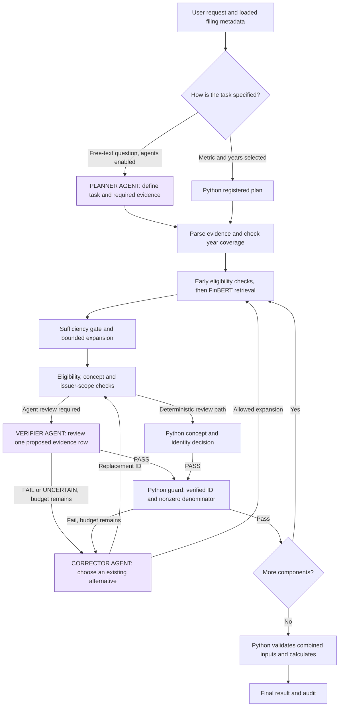
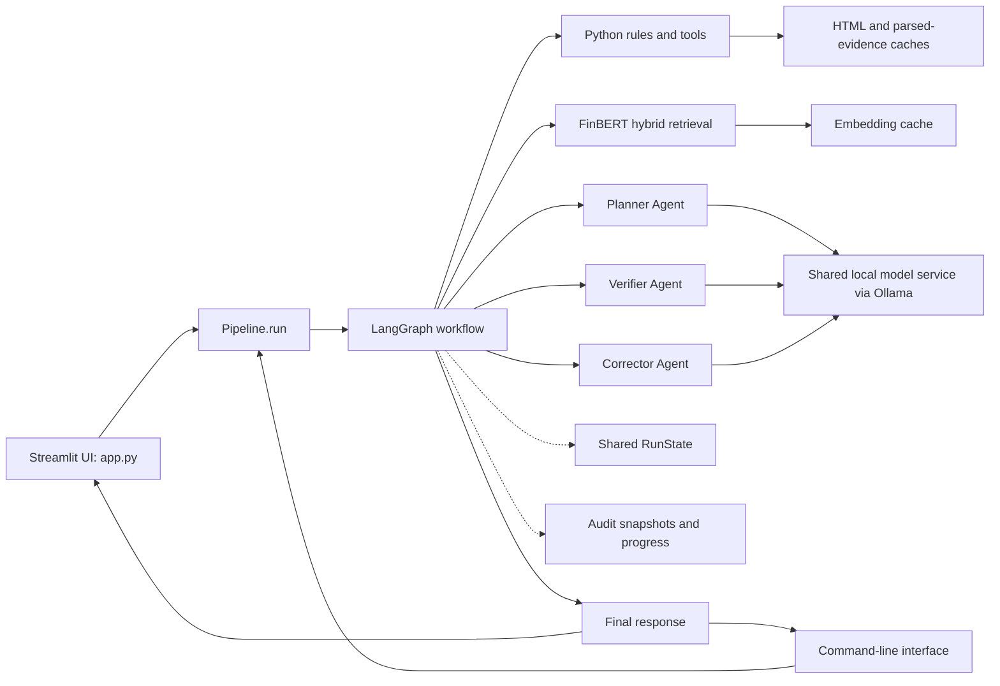
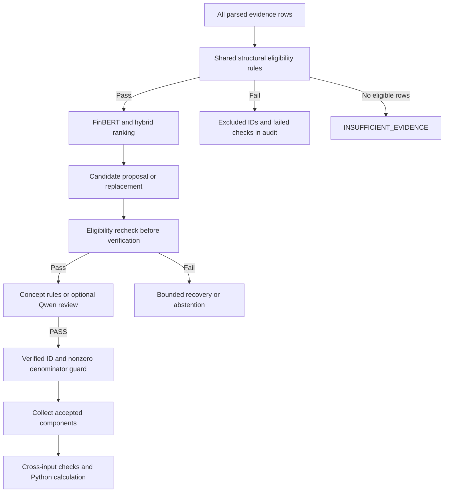

# Current program structure

Verified against the working tree on November 12, 2026. This describes the implemented program, including early eligibility and the simplified post-verification guard.

## How to read the diagrams

LangGraph is the workflow controller. It runs 14 application nodes, passes a shared `RunState` between them, and follows conditional routes. Three nodes host the **Planner Agent**, **Verifier Agent**, and **Corrector Agent**. The other nodes execute Python tools or rules. FinBERT ranks evidence; Python performs the final arithmetic.

The latest change updated behavior inside existing nodes. It did not change the graph's node names or registered edges. Supporting-source selection and early eligibility are helper operations, so they should not be mistaken for separately registered LangGraph nodes.

The [README overview](../README.md#responsibilities-and-graph) shows the main flow. The [complete Mermaid export](current_langgraph.mmd) is generated directly from the compiled graph and includes all 34 registered edges, including terminal exits and the correction self-loop. Registered edges describe possible transitions, not the path every request takes.

## The three agents and when they run

| Agent | LangGraph node and implementation | Role and output | When the agent is called |
|---|---|---|---|
| **Planner Agent** | `plan_task`; [`agents/planner.py`](../src/financial_filing_agent/agents/planner.py) | Interprets the question, selects an allowlisted formula, required components, explicit fiscal years, statement types and retrieval queries. Returns a structured plan, `NEEDS_INPUT` or `UNSUPPORTED_TASK`. | After loading filing metadata, for a free-text task with agents enabled. Selecting a registered metric and years builds the plan directly in Python, bypassing this agent. |
| **Verifier Agent** | `verify`; [`agents/verifier.py`](../src/financial_filing_agent/agents/verifier.py) | Reviews one proposed row for one component. Checks unresolved accounting meaning, reporting scope and other permitted context against source observations. Returns structured `PASS`, `FAIL` or `UNCERTAIN` checks. | After retrieval/sufficiency proposes an eligible row. It can run again for a replacement selected by the Corrector Agent. It is bypassed when agents are disabled or all required checks are established by Python source evidence; a Python accounting identity can resolve the accounting concept. |
| **Corrector Agent** | `correct`; [`agents/corrector.py`](../src/financial_filing_agent/agents/corrector.py) | Uses the rejection reasons and existing eligible alternatives to return `REPLACE` with an existing evidence ID, `EXPAND_SEARCH` if permitted, or `NO_VALID_EVIDENCE`. | On a rejected/uncertain review, failed final guard, or recoverable calculator input incompatibility, while recovery budget remains. A model call requires available candidates; the surrounding Python stage can expand or abstain when none remain. With agents disabled, deterministic replacement rules apply. |

These are three role-specific agents sharing a local model service. They have separate prompts, payloads and output schemas in [`config/prompts.py`](../src/financial_filing_agent/config/prompts.py). LangGraph invokes them at different stages. They do not run as three permanently active processes, and a request need not call all three.

The Planner Agent does not retrieve financial rows or calculate the answer. The Verifier Agent does not choose replacements or request expansion. The Corrector Agent corrects evidence selection; it cannot edit reported values, invent a source row or approve its own replacement. Every replacement returns to verification and then the final guard.

The following diagram emphasizes agent calls and bypasses. It is a role view, rather than one box per registered graph node. Purple boxes are the three agents; the other boxes are tools, rules or routing decisions. Terminal failures and the full set of recovery edges are omitted for readability.



Agent call counts differ by task. For the retained Tesla current-ratio test, the Planner Agent was bypassed because the metric was explicitly selected; the Verifier Agent ran twice, once for current assets and once for current liabilities; the Corrector Agent was not called because both selections passed. A free-text version of that request would first invoke the Planner Agent. A rejected selection could additionally invoke the Corrector Agent and another Verifier Agent review.

## Application layers



Solid arrows show calls, data access, or returned results. Dotted arrows show shared workflow state and observational records. All nodes operate through the pipeline; the UI and CLI do not implement agent routing.

## The 14 graph nodes

| Graph node | What executes inside it | Normal next step or alternatives |
|---|---|---|
| `validate_request` | Checks source and question/selected metric. | `load_filing`; incomplete input finishes with `NEEDS_INPUT`. |
| `load_filing` | Loads local HTML or acquires a supported SEC source, hashes/caches bytes, extracts filing metadata. | `plan_task`; acquisition errors finish with `ERROR`. |
| `plan_task` | Builds a registered metric plan or calls the Qwen planner for free text. | `build_evidence`; incomplete/unsupported requests finish. |
| `build_evidence` | Parses tables and inline XBRL or reuses the versioned parser cache; safely handles split numeric display fragments and preserves source cells. Saves per-run evidence. | `check_inputs`. |
| `check_inputs` | Inventories component/year coverage. If periods are missing, checks permitted same-company supporting filings and may select one complete filing. | `retrieve_component`; unresolved missing periods finish with `INSUFFICIENT_EVIDENCE`. |
| `retrieve_component` | Filters structurally ineligible rows, ranks the remaining rows with FinBERT/lexical/XBRL signals, exposes the initial top-k. | `assess_sufficiency`; no eligible/ranked candidates finishes with `INSUFFICIENT_EVIDENCE`. |
| `assess_sufficiency` | Removes already rejected IDs and checks support in the candidate pool. | `verify` when sufficient or still uncertain after expansion; `expand_search` when allowed; otherwise finish. |
| `expand_search` | Reapplies eligibility, reranks parsed rows and exposes the full eligible ranking beyond top-k. | `assess_sufficiency`; exhausted/error cases finish. |
| `verify` | Rechecks the proposed row's eligibility before any decoder call; assesses accounting meaning, optional gross-profit identity and source-backed issuer scope. All-resolved checks bypass Qwen; otherwise the agent cites evidence IDs for open checks. | `guard` on PASS; `correct` while recovery remains; otherwise finish. |
| `guard` | Checks that the latest PASS belongs to the exact selected ID and that required denominator periods are present and nonzero. Relies on eligibility before verification. | `next_component` on acceptance; `correct` while recovery remains; otherwise finish. |
| `correct` | Removes failed/rejected/ineligible candidates. Qwen chooses an existing ID or deterministic rules require a unique supported replacement when Qwen is off. | `verify`, `expand_search`, bounded `correct` retry, or finish. |
| `next_component` | Advances the component index. | `retrieve_component` for another component; `calculate` after all components are accepted. |
| `calculate` | Calls the registered Python calculator, which checks complete coverage, verified IDs, valid monetary inputs, cross-component currency/date compatibility and defined arithmetic. Does not repeat the acceptance guard. | Finish with `SUCCESS`; recoverable calculator input incompatibility can return to `correct` while budget remains. |
| `finish` | Builds the final response from status, evidence, calculation, warnings and errors. | LangGraph `END`; the pipeline then completes timings/version records and saves the final audit. |

Each node is wrapped to emit progress, measure timing and persist audit snapshots. An `EvidenceError` caught by that wrapper produces `INSUFFICIENT_EVIDENCE`; other operational exceptions produce `ERROR`. The router sends a set final status to `finish`. These shared terminal routes account for many arrows in the full export.

The current parser version is `ixbrl-table-v9`, prompt version is `4`, and Verifier contract version is `2`. Structured headings, row groups, issuer/context identities and consolidation declarations are preserved with source locations. Exact repeated XBRL facts can link a note total to an established primary statement. Empty dimensions alone do not establish scope. Incomplete numeric display fragments no longer throw during evidence-text construction. XBRL sign/scale/context remains authoritative; plain-HTML split parentheses are reconstructed only within one row and an explicit fiscal-year group containing one numeric payload. Ambiguous spans and unsupported cross-row joins remain unresolved. The loader requires explicit complete ISO or English month/day/year dates rather than defaulting missing years to the current date. Versioned evidence/embedding caches are rebuilt, and source date metadata is reparsed even on a filing-cache hit.

`START` and `END` are LangGraph sentinels, outside the count of 14 application nodes. Statuses such as `SUCCESS` and `ERROR` are values in shared state, not additional nodes.

## Where the new early checks run



This is an internal processing view, not another LangGraph. The eligibility helper checks source/hash membership, nonempty label, expected statement, unique requested-period facts, finite values, supported monetary units/basis, within-row currency consistency, absence of restricted dimensions, instant/duration kind and annual duration where available. It preserves the existing treatment of missing metadata; passing these checks is not a claim that accounting meaning or every reporting-scope question is resolved.

`retrieve_component` and `expand_search` call `rank_eligible` before the retriever. `correct` rechecks candidate eligibility before presenting replacements. `verify` rechecks the selected row before reviewing it. The original parsed rows stay in the evidence artifact; filtering records why an ID was excluded.

Revenue also has a separate semantic basis policy within the existing nodes. A structurally supported reported revenue total takes precedence over net sales for registered revenue metrics, including when the total covers only some requested years. Conflicting reported totals block acceptance. Retrieval/expansion and correction filter incompatible basis choices; verification independently enforces the same policy before any model call. Net sales remains supported when no separate revenue total is found. Revenue-basis decisions are retained in retrieval diagnostics, concept assessments and the final response. This adds no LangGraph node and does not make structural eligibility a semantic approval.

Verification-dependent checks stay later: `guard` requires the latest verification record to PASS the exact selected ID and checks the formula denominator. For growth, only the earlier year's amount is a denominator; ratios require a nonzero denominator for each calculated year. The guard does not call structural eligibility again or maintain a separate validation certificate. It relies on the source rows already checked before verification. The calculator retains its own input contract, including verified IDs and compatibility across the actual accepted components. A structurally eligible row can still represent the wrong accounting concept, so eligibility does not authorize arithmetic.

Expansion retains its internal `ALL_PARSED_STATEMENTS` scope label, but the eligibility rules still require the expected statement and valid context. With the current implementation, the broader usable pool is the full eligible ranking rather than the initial top-k.

## Qwen modes

| Operation | Qwen enabled | Qwen disabled |
|---|---|---|
| Explicit metric and years | Registered Python plan. | Same registered plan. |
| Free-text question | Qwen planner chooses a supported task with explicit years. | `NEEDS_INPUT`: choose a metric and years. |
| Evidence review | Python eligibility/concept checks first; Qwen reviews unresolved checks. Source-backed scope and concept checks can resolve every check without Qwen. A gross-profit identity can establish the concept. | Deterministic registered concept rules; uncertainty cannot become accepted evidence. |
| Correction | Qwen can select an existing eligible candidate or request bounded expansion. | A unique existing rule-supported replacement is required. |
| Ranking and calculation | FinBERT retrieval and Python arithmetic. | Same models/tools for these responsibilities. |

The default recovery limits are two correction rounds and one expansion per component. Contract repair and decoder transport retries have their own bounded paths inside agent/decoder code; they are not extra graph nodes.

## Historical Tesla example through the graph

The retained November 11 baseline run, before the source-scope change, followed the main path twice through the component loop: first current assets, then current liabilities. Explicit metric selection bypassed Qwen planning. Each component used one Qwen verification call, passed its final guard, and reached the Python calculator without correction or expansion.

The VIE footnote's identically labelled totals were excluded by early `consolidated` checks because they carry a restricted XBRL dimension. The consolidated balance-sheet totals remained eligible. See the [saved case summary](../artifacts/tesla-current-ratio/check-summary.json); it records the actual HTML mirror, SEC accession, source hash, selected/excluded IDs, result and audit path. This retained local artifact may be absent in another clone.

## Source map

| Responsibility | Source |
|---|---|
| Node registration and allowed edges | [`graph/workflow.py`](../src/financial_filing_agent/graph/workflow.py) |
| Final-status versus next-route selection | [`graph/routing.py`](../src/financial_filing_agent/graph/routing.py) |
| Node implementations, wrapping and execution | [`services/pipeline.py`](../src/financial_filing_agent/services/pipeline.py) |
| Shared serializable state | [`schemas/state.py`](../src/financial_filing_agent/schemas/state.py) |
| Structural eligibility and post-verification acceptance guard | [`tools/validation.py`](../src/financial_filing_agent/tools/validation.py) |
| Registered concepts and gross-profit identity | [`tools/concept_validation.py`](../src/financial_filing_agent/tools/concept_validation.py) |
| Component/year inventory and permitted supporting sources | [`tools/input_inventory.py`](../src/financial_filing_agent/tools/input_inventory.py), [`tools/supporting_filing.py`](../src/financial_filing_agent/tools/supporting_filing.py) |
| Hybrid ranking and embeddings | [`retrieval/hybrid_retriever.py`](../src/financial_filing_agent/retrieval/hybrid_retriever.py) |
| Cross-input validation and arithmetic | [`tools/calculator.py`](../src/financial_filing_agent/tools/calculator.py) |
| Local Qwen requests | [`models/local_decoder.py`](../src/financial_filing_agent/models/local_decoder.py) |

## Regenerate the complete graph export

Run from the repository root. This uses the real pipeline's node mapping and builds the graph without invoking it, so it does not load FinBERT, call Ollama, acquire filings or run calculations.

```bash
.venv/bin/python - <<'PY'
from pathlib import Path
from financial_filing_agent.services.pipeline import Pipeline
from financial_filing_agent.graph.workflow import build_graph

pipeline = Pipeline()
nodes = {
    "validate_request": pipeline.validate_request, "load_filing": pipeline.load,
    "plan_task": pipeline.plan, "build_evidence": pipeline.evidence,
    "check_inputs": pipeline.check_inputs, "retrieve_component": pipeline.retrieve,
    "assess_sufficiency": pipeline.sufficiency, "expand_search": pipeline.expand,
    "verify": pipeline.verification, "guard": pipeline.guarding,
    "correct": pipeline.correction, "next_component": pipeline.next_component,
    "calculate": pipeline.calculation, "finish": pipeline.finish,
}
diagram = build_graph(nodes).get_graph().draw_mermaid()
Path("reports/current_langgraph.mmd").write_text(diagram, encoding="utf-8")
PY
```

Current Verifier outputs use source IDs from a row-bound catalogue. Python resolves the actual excerpts and aggregates PASS/FAIL/UNCERTAIN. An invalid review gets one repair, then ERROR; valid uncertainty uses bounded recovery. A rejected row stays excluded; an uncertain row can be reconsidered only when its supporting-evidence fingerprint changes. The graph retains the same 14 nodes.
