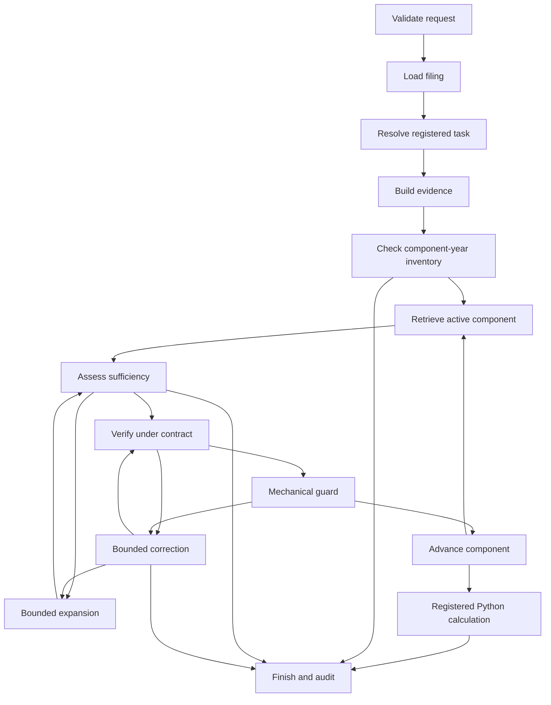

# Agentic AI Risk Management for Financial Filing Analysis

## Midterm research and technical presentation foundation

**Project:** Evidence-grounded analysis of financial metrics in SEC filing HTML  
**Implementation examined:** `SEC_Agent`, as available at the November 3, 2026 project checkpoint  
**Purpose:** A detailed explanation of the current system, its development failures, its actual run evidence, and its connection to Agentic AI Risk Management

This report is designed to support a midterm presentation and the discussion behind that presentation. It explains the implemented application rather than proposing an architecture that has not been built. Suggested figures include enough information to draw them manually. The run references point to retained local artifacts; they are not claims of independent external financial validation.

### Central argument

The project investigates how to let AI assist with financial evidence selection while keeping the authority to define calculations, accept evidence, and release an answer under explicit program control. The difficult part is often not the arithmetic. It is deciding whether a number represents the right concept, company scope, reporting period, unit, and formula input.

An especially useful result comes from the Tesla current-ratio run. The retriever selected rows with the right labels, years, and XBRL concept names. Qwen approved those rows. However, the values described a Variable Interest Entity subset rather than Tesla's complete consolidated current assets and liabilities. A separate Python guard rejected the dimensioned facts, a bounded recovery process selected the primary balance-sheet rows, and Python then calculated the final ratios. The successful final answer therefore demonstrates an effective recovery path **and** a real model error inside that path.

This distinction is the research theme of the project: managing an agentic system requires controlling what each model may observe, decide, and cause—not simply asking a model to be more careful.

### Reading conventions and evidence boundaries

- **Implemented** means the behavior can be located in the current source code. It does not imply that every possible filing format is supported.
- **Observed** means a retained run or test report records the behavior. A successful run is a case study, not a statistical guarantee.
- **Recommended** means a future improvement. Recommendations are separated from claims about the current application.
- **Deterministic** describes a specified Python operation applied to specified inputs. It does not mean that those inputs are automatically the correct financial evidence.
- **Agent** refers here to a constrained model-driven role embedded in a stateful workflow. The application does not implement several independent human-like analysts having an open-ended conversation.
- The Apple converted filing and Tesla uploaded filing are analyzed as retained project sources. This report does not independently authenticate their contents against a newly downloaded SEC copy.
- The run corpus contains development experiments, repeated questions, different configurations, failures, and partial runs. Its aggregate status counts must not be presented as accuracy measurements.

## 1. The problem the project is trying to solve

### 1.1 The apparent simplicity of financial questions

A user may ask, “How did total revenue change?”, “What is the change in current ratio?”, or “What is R&D intensity?” Each question sounds simple because its mathematical expression is short. Revenue growth is a subtraction and division; a current ratio is current assets divided by current liabilities; R&D intensity is research and development expense divided by revenue.

The real input to these calculations is a financial document, not a clean spreadsheet with already approved variables. A filing contains primary statements, notes, repeated labels, comparative years, subtotals, segment disclosures, currency and scale conventions, and machine-readable contexts. Several numbers can look equally plausible when reduced to a short label.

For example, a filing can contain both a consolidated balance-sheet row called “Total current assets” and a note row with the same label for a limited group of entities. Both may use `us-gaap:AssetsCurrent`, refer to the same fiscal years, and be expressed in the same currency. The missing distinction is reporting scope. A perfectly executed division of the wrong pair of rows still produces an incorrect financial answer.

### 1.2 Why a text-similarity system alone is insufficient

An encoder can rank passages by semantic similarity, but similarity is not equivalence. “Total cost of sales” is linguistically and financially related to “total net sales.” A note about current assets can have a higher embedding score than the primary balance-sheet row. A value labeled “Gross margin” can represent an amount in one table and a percentage in another.

The project therefore needs to move from “retrieve something related” to “justify a particular source fact for a particular formula role.” This requires evidence identity, concept resolution, period coverage, value dimension, entity scope, and controlled acceptance rules.

### 1.3 Why a general-purpose decoder alone is insufficient

A decoder can interpret financial language and suggest a plausible correction. It can also invent a requirement, confuse an amount with a ratio, accept a misleading context, or repeat a previous model's mistaken reason. The development logs show all of these mechanisms in concrete form.

One particularly revealing failure was the treatment of an optional accounting-identity certificate as mandatory evidence. The revenue row was already mapped to “Total net sales,” but Qwen demanded an additional identity or reconciliation. The corrector then inherited that invented requirement and expanded the search. The system was spending more effort because it had accepted a model-generated rule that was never part of the task.

### 1.4 The intended user-facing behavior

The application should identify a supported metric and explicit fiscal periods, obtain suitable filing evidence, collect every required component, verify and guard those components, calculate with registered Python logic, compare periods with Python logic, and show the answer with a traceable explanation. If a necessary period or component is absent, it should explain the absence. If the model violates its output contract or the runtime fails, it should report an operational error rather than disguise it as missing financial evidence.

These are different terminal outcomes. A system that always prints a number would be less trustworthy than one that can distinguish a supported answer, a legitimate abstention, an incomplete request, an unsupported task, and a runtime error.

### 1.5 Research questions

The current project supports five practical research questions:

1. Can a financial encoder help find candidate evidence without being granted the authority to accept it?
2. Can a local decoder review ambiguous evidence within a narrow, executable decision boundary?
3. Can independent structural checks stop errors that pass both retrieval and model review?
4. Can recovery remain useful while being bounded, auditable, and unable to invent financial values?
5. Can a final answer expose the distinction between model interpretation, verified source facts, and deterministic computation?

These questions place the work squarely within Agentic AI Risk Management: the object of study is the behavior and control of the whole decision process.

**Suggested Figure 1 — Why correct arithmetic is not enough.** Draw a left-to-right chain with six boxes: Question → Formula dependencies → Source rows → Accepted facts → Python calculation → Answer. Under “Source rows,” draw two branches labeled “correct label, wrong scope” and “correct consolidated fact.” Show that either branch can enter a calculator unless an acceptance gate separates source selection from computation. Highlight that gate as the central risk-control boundary.

## 2. From the notebook prototype to the current application

### 2.1 The original research prototype

The original notebook, `M4_InitialResults_multiagent1py1.ipynb`, remains a research record. It contains controlled candidate-selection experiments using FinBERT representations and Python calculations. The encoder uses attention-mask-aware mean pooling, L2 normalization, and cosine similarity. Its token limit is 256. These choices continue to inform the application implementation.

The notebook's controlled clean setting reported 5/5 component selections and 3/3 task claims. Under similar-term and broader candidate stress, the baseline fell to 0/5 components and 0/3 claims. A dual-view FinBERT variant improved one similar-term component selection but did not solve the claim-level failures. An exact-alias repair condition repaired the controlled cases, but that condition was privileged and should be treated as a diagnostic upper bound, not a deployable general solution.

The Qwen extension saved development results of 15/15 component selections, 9/9 task claims, detection of 10/10 injected errors, and one false rejection among five correct selections. These are small, controlled, development-specific observations. The candidate generator deliberately included known correct evidence, and the saved notebook also contains a final kernel-state-related `NameError`. The results motivate the architecture; they do not establish general reliability.

### 2.2 What changed in the application

The application adds actual filing loading, HTML and Inline XBRL parsing, explicit evidence schemas, formula registration, multi-component handling, a LangGraph workflow, bounded decoder review and recovery, a Streamlit interface, and persistent audit artifacts.

This is a substantive change in the experimental object. The notebook mainly asks whether a known answer can be selected from a controlled candidate set. The application must also ask whether the needed fact exists in the supplied filing, whether the parser attached the right year and scope, and whether a model's review is itself valid.

### 2.3 Why the migration matters for risk management

In a notebook, hidden state, hand-selected candidates, and embedded expected answers can accidentally make a system look more capable than it is. A runtime application needs to separate development references from operational inputs. The application does not give gold answers to the planner, verifier, or corrector. Test doubles and controlled stress retrievers live under `evaluation/`; they are not ordinary filing-analysis capabilities.

The migration also makes failures inspectable. A result is accompanied by selected source IDs, candidate rankings, verification records, guard results, model call records, and timing information. This supports investigation of how an answer was obtained, rather than merely whether its final number looks reasonable.

## 3. System overview: brains, field of view, tools, and orchestration

### 3.1 Four concepts that must remain distinct

The **brain** is the model or rule system used for a decision. In this project, FinBERT provides semantic representations, Qwen provides structured language-based judgments, and Python implements formal rules and arithmetic.

The **field of view** is the exact information supplied to a decision-maker. A verifier that sees one candidate row has a different role from a corrector that sees a bounded set of alternatives. A decoder that sees an unexplained `UNAVAILABLE` certificate field may infer a missing requirement; a decoder that sees only the open checks has less opportunity to expand the task.

The **tools** are concrete capabilities implemented by the application: loading a filing, parsing tables, ranking candidates, validating units, checking scope metadata, calculating a registered metric, and writing an audit. The model does not receive unrestricted access to Python, the filesystem, or the web.

The **orchestration** is the program that determines which role or tool runs next, what state it receives, and which outcomes may change the route. Here, that orchestration is an explicit LangGraph state graph implemented around a `RunState` object.

### 3.2 A layered view of the application

| Layer | Main responsibility | Representative implementation |
|---|---|---|
| User interaction | Collect source, question or registered metric, periods, and configuration; display progress and results | `ui/streamlit_app.py`, `ui/components.py` |
| Control and orchestration | Own state, route nodes, enforce budgets, distinguish outcomes | `services/pipeline.py`, `graph/workflow.py`, `graph/routing.py` |
| Cognitive assistance | Map language to a registered task; rank evidence; review ambiguity; suggest bounded recovery | `agents/`, `models/`, `retrieval/` |
| Evidence and source processing | Load filings, parse tables and contexts, normalize facts, preserve provenance | `tools/filing_loader.py`, `filing_parser.py`, `xbrl.py`, `evidence_builder.py` |
| Deterministic acceptance and computation | Enforce concept, period, unit, scope, membership, and formula conditions; calculate | `tools/concept_validation.py`, `validation.py`, `calculator.py` |
| Observability and persistence | Store requests, source identity, intermediate decisions, model outputs, timings, and final state | `services/audit.py`, `cache.py`, `progress.py` |

These are logical responsibilities, not separate deployed servers. Most are ordinary Python modules in one application process. Ollama is the local decoder service; the application calls it through HTTP.

### 3.3 The role-and-authority matrix

| Role | Brain | Field of view | Permitted effect | Authority it does not have |
|---|---|---|---|---|
| Planner | Qwen, or deterministic registered menu | Question, filing metadata, periods, formula registry | Propose a validated task plan | Create formulas, fabricate years, compute answers |
| Retrieval subsystem | FinBERT plus lexical and XBRL-name signals | Candidate evidence rows and component query | Rank existing rows and propose an ID | Declare a financial fact accepted |
| Sufficiency assessor | Python rules | Candidate structure and required component/years | Route to review, bounded expansion, or termination | Treat ranking as proof |
| Verifier | Optional Qwen, constrained by Python contract | One row, one component, permitted open checks | Return source-grounded structured observations | Select alternatives, add dependencies, expand search, calculate |
| Mechanical guard | Python | Exact proposed row, source facts and task requirements | Reject invalid or incompatible evidence | Repair missing source facts by guessing |
| Corrector | Optional Qwen | Bounded existing alternatives and accepted findings/guard failures | Request an allowed replacement, limited expansion, or no valid evidence | Invent rows, values, tools, formulas, or unlimited search |
| Calculator/comparator | Python registered functions | Complete accepted and verified inputs | Produce metric, changes, direction, units | Find evidence or reinterpret labels |
| Orchestrator | Python/LangGraph | Full serializable run state | Decide legal next transition and enforce budgets | Delegate unrestricted control to decoder prose |
| Audit service | Python | State snapshots and decoder-call records | Persist a reviewable execution trace | Certify that every interpretation is financially correct |

The retrieval subsystem is AI-assisted, but FinBERT is not an autonomous agent. Likewise, the guard and calculator are tools or policy modules, not language-model agents. Calling everything an “agent” would obscure where uncertainty actually enters.

### 3.4 What “multi-agent” means in this implementation

Planner, verifier, and corrector are separate roles with different prompts, inputs, schemas, and decision permissions. They use the same local decoder model, `qwen2.5:latest`, rather than three independently trained models. Calls are stateless requests; previous successes do not automatically become persistent model memory.

The workflow is sequential. It does not use a group chat, voting committee, distributed message bus, or parallel analyst debate. Role separation improves clarity and control, but it does not create statistical independence. The same model can repeat the same misconception in verification and correction unless program boundaries interrupt it.

This is why the project relies on heterogeneous defenses: language review is combined with source metadata, formula registration, Python validation, finite budgets, and auditability.

### 3.5 A precise architecture diagram specification

**Suggested Figure 2 — System architecture with authority boundaries.** Use five horizontal bands:

1. Top band: Streamlit UI, with inputs for filing, metric/question, periods, Qwen switch, and optional supporting sources.
2. Second band: a large “Pipeline + LangGraph orchestration” box containing the shared `RunState` and routing/budget logic.
3. Third band: three model-role boxes—Planner, Verifier, Corrector—and a separate FinBERT retrieval box. Put “same Qwen model, different contracts” above the three role boxes.
4. Fourth band: Python tools—Source Loader, Parser/Evidence Builder, Inventory, Concept Rules, Mechanical Guard, Registered Calculator.
5. Bottom band: artifacts and caches—source HTML, parsed evidence, embeddings, per-run audit, final report.

Use solid arrows for program-controlled execution and dashed arrows for model suggestions. Route model outputs back into the orchestration box before any tool action. Place a thick acceptance boundary between Verifier/Corrector suggestions and the Calculator. Only evidence that passes the guard can cross it. Draw audit arrows from all major bands to the per-run audit artifact.

## 4. Project structure and responsibilities

### 4.1 Entry points and configuration

`app.py` is the user-facing Streamlit entry point. `src/financial_filing_agent/cli.py` provides a command-line interface. `pyproject.toml` declares the package and dependencies, while the lock file captures a development dependency snapshot. Runtime model and package information is additionally recorded in the audits because environments can change.

`config/settings.py` defines validated settings, including model identities, encoder revision, device, candidate count, retrieval weights, correction and expansion budgets, decoder context/output limits, parser version, prompt version, and artifact directory. A configuration fingerprint helps identify whether two runs used the same effective settings.

`config/formulas.py` is the executable registry of supported financial calculations. `config/financial_concepts.py` holds canonical concepts, expected statements, known aliases, and supported taxonomy names. `config/prompts.py` contains the actual planner, verifier, and corrector system prompts. These are distinct responsibilities: a prompt describes a role, whereas the formula registry defines valid calculations and the concept registry defines approved mappings.

### 4.2 Schemas as component boundaries

The `schemas/` package defines task plans, evidence, results, and shared state. Pydantic models reject unsupported fields and invalid structures at important boundaries. Numeric fields are validated rather than accepting arbitrary strings as financial values.

`RunState` is a serializable dictionary-shaped state contract. It carries request identity, source identity, metadata, parsed evidence references, task dependencies, retrieval results, verification results, correction history, accepted IDs, guard results, calculation output, warnings, errors, timing data, configuration, and routing counters.

The shared state is the workflow's explicit memory. It is not a hidden conversational transcript. Live model objects, tensors, HTTP sessions, and DataFrames are kept outside that state. The pipeline owns or receives these runtime resources and passes ordinary data to nodes. This improves persistence, inspection, and reproducibility.

### 4.3 Models and retrieval modules

`models/finbert.py` loads the encoder, performs batched embedding, pools token representations with the attention mask, normalizes vectors, and supports the configured device. The encoder is reused within the process rather than loaded for every component.

`models/local_decoder.py` is the Ollama client. It sends a system prompt, a JSON task payload, and a structured output schema. It records request and response information, validates results, and handles bounded transport or parse retries. It is an adapter around the local model service, not an open-ended tool executor.

`retrieval/finbert_retriever.py`, `lexical_retriever.py`, and `hybrid_retriever.py` separate semantic and auxiliary ranking signals. `retrieval/sufficiency.py` evaluates whether a proposed row has enough structural support to proceed or whether a search action is needed.

### 4.4 Agents and executable review boundaries

`agents/planner.py` maps a free-form question to a supported plan. `agents/verifier.py` builds a review request for one row and invokes the decoder. `agents/verification_contract.py` determines what remains open for model judgment, generates a request-specific schema, and validates source-grounded observations. `agents/corrector.py` implements bounded recovery suggestions.

Keeping `verification_contract.py` separate is architecturally significant. A system prompt alone cannot enforce that a model review only reporting scope, cite the actual source, or stop demanding unrelated certificates. The contract layer supplies executable checks beyond natural-language instructions.

### 4.5 Tools and services

The `tools/` package contains source acquisition, HTML parsing, Inline XBRL handling, numeric normalization, evidence construction, input coverage inventory, optional supporting-filing selection, concept validation, mechanical validation, and calculation.

`services/pipeline.py` connects those tools and roles into node functions. `graph/workflow.py` declares legal transitions. `services/progress.py` emits user-visible execution events. `services/cache.py` and `audit.py` handle persistence and caching, including Windows file-replacement reliability measures.

### 4.6 Evaluation and tests

`evaluation/` contains fixtures, metrics, notebook snapshot material, demonstrations, and test doubles. Its contents support controlled experiments. They must not be confused with unrestricted real-world inference capabilities.

The `tests/` package covers application routing, parsing, sources, FinBERT behavior, metric dependencies, Qwen modes, runtime reliability, UI behavior, and verifier contracts. The retained full-suite report records 94 tests: 93 passed and one CUDA-dependent test skipped. This is engineering validation of the covered behaviors, not a financial-answer accuracy benchmark.

### 4.7 Compact source tree

```text
SEC_Agent/
  app.py
  pyproject.toml
  requirements-lock.txt
  config/research.json
  src/financial_filing_agent/
    cli.py
    config/        settings.py, prompts.py, formulas.py, financial_concepts.py
    schemas/       state.py, evidence.py, task.py, results.py
    models/        finbert.py, local_decoder.py
    retrieval/     finbert_retriever.py, lexical_retriever.py,
                   hybrid_retriever.py, sufficiency.py
    agents/        planner.py, verifier.py, verification_contract.py, corrector.py
    graph/         workflow.py, routing.py
    services/      pipeline.py, audit.py, cache.py, progress.py
    tools/         html.py, sec_client.py, filing_loader.py, filing_parser.py,
                   xbrl.py, evidence_builder.py, numeric_parser.py,
                   validation.py, calculator.py, input_inventory.py,
                   supporting_filing.py, concept_validation.py
    ui/            streamlit_app.py, components.py
  evaluation/      fixtures, demonstrations, metrics, controlled doubles
  tests/           application, source, parser, model, contract, UI regressions
  artifacts/
    runs/<run_id>/ audit.json, evidence and related per-run artifacts
    uploads/       retained uploaded HTML identified by content hash
    ...            source, parsed-evidence, and embedding caches
  reports/midterm/ this report and its evidence index
```

## 5. The brains in detail

### 5.1 FinBERT: a retrieval representation model

The encoder is `yiyanghkust/finbert-pretrain`, pinned in settings to revision `88ab954a39ea6d3ce2b62cff086dd5ad1172c664`. Its role is to represent a query and evidence rows in a shared vector space. It does not calculate ratios, read the entire filing as an autonomous analyst, or decide final truth.

For token representations `h_i` and attention-mask values `m_i`, the pooled vector is the masked mean:

```text
v = sum(m_i * h_i) / sum(m_i)
u = v / ||v||
similarity(query, row) = dot(u_query, u_row)
```

The mask prevents padding tokens from contributing equally to the average. L2 normalization makes dot product correspond to cosine similarity. The 256-token limit means each representation sees a bounded text view; it is not a complete encoding of all table relationships or filing context.

Embedding caches are keyed with source/parser/model and text-related identity so that changed content or model settings do not silently reuse unrelated vectors. Batching and process-level model reuse reduce repeated loading and inference cost. Device settings permit CPU, CUDA, or automatic selection; actual run metadata is more informative than a general statement that the project “uses a GPU.”

### 5.2 Hybrid ranking

The current default score is:

```text
hybrid_score = 1.0 * semantic_cosine
             + 0.25 * lexical_Jaccard
             + 0.25 * XBRL_name_support
```

The lexical and taxonomy signals help counter some semantic confusions. They do not remove the need for validation. A hybrid score can exceed 1 and is not a probability. A supported XBRL concept name is a useful signal, but it does not establish that the fact has the right dimensional scope.

This is visible in the Tesla current-ratio case: the wrong VIE rows had the expected labels and taxonomy names, so the auxiliary signals could not distinguish them from company-wide totals. A later guard was necessary.

### 5.3 Qwen: one model, three constrained cognitive roles

The configured local decoder is `qwen2.5:latest`, called through Ollama's `/api/chat`. Retained model records include a digest; the named model tag alone is not a permanent model-version guarantee. The audited digest in the examined late runs is `845dbda0ea48ed749caafd9e6037047aa19acfcfd82e704d7ca97d631a0b697e`.

Temperature defaults to zero, context length to 16,384, and output allowance to 1,200 tokens. These settings improve control but do not create mathematical determinism across every model implementation or runtime. The important deterministic boundaries are the Python rules applied to the output.

There is no automatic durable memory that “revenue meant Total net sales last time.” Each call must receive the approved concept mapping and its current task boundary. Shared application state, rather than an assumed model memory, carries continuity.

### 5.4 Planner anatomy

**Objective:** Translate a user's wording into one of the registered tasks and explicit fiscal periods.

**Field of view:** The question, source metadata, any explicit requested periods, and supported formula/concept information. It does not see a hidden expected answer.

**Output:** A typed plan containing status, formula ID, required components, required periods, expected statement types, retrieval queries, and notes.

**Tool relationship:** The planner does not run calculations or browse for evidence by itself. Its validated plan tells the orchestrator which tools and components will be needed.

**Control boundary:** A task outside the formula registry must not become an executable invented formula. The metric menu bypasses this language-model planning step entirely and constructs dependencies through `registered_plan`.

**Known limitation:** An observed request for growth in R&D intensity led Qwen to emit an unregistered formula and produced a planning `ERROR`. The registry supports one-period `rd_intensity`, not a registered change/growth variant. The schema prevented an invented calculation, but the user-facing classification could be improved to a clearer unsupported-task response.

### 5.5 Verifier anatomy

**Objective:** Review one proposed evidence row for one required component, and only review checks that Python has left open.

**Field of view:** The selected row, component definition, allowed aliases or supported taxonomy names, expected value dimension and statement, required years, formula role, Python concept assessment, and a generated verification contract.

The decoder-facing fact view is deliberately reduced: it keeps requested-period normalized facts while omitting raw cells, raw value strings, context IDs, and scale details. The nearby text is also bounded. Full artifacts retain richer provenance. This reduces noise but creates an important trade-off: a smaller view can omit context that is useful for interpreting a note. Mandatory guards still inspect structural facts outside the decoder's interpretation.

**Output:** Structured observations for each allowed check, including status, evidence field, observation type, source quotation, and reason. Python derives overall verdict, findings, and primary error type from those observations.

**Control boundary:** The verifier cannot choose a replacement, invoke search, invent a new formula dependency, require an optional identity certificate, or perform arithmetic. Its confidence is recorded but is not a calibrated acceptance probability.

**Failure modes:** It may still interpret a true quotation incorrectly. The Tesla VIE case passed quote and contract validation because “consolidated balance sheets” appeared in the supplied context, yet that phrase described where a subset was consolidated rather than establishing that the disclosed amounts were company-wide totals.

### 5.6 Corrector anatomy

**Objective:** Recover from an accepted verification finding or mechanical guard failure by selecting valid existing evidence or requesting a permitted search expansion.

**Field of view:** Bounded candidate chunks, the rejected ID, structured findings accepted by the program, guard results, task scope, correction history, and whether expansion remains allowed. Free-form erroneous verifier explanations and irrelevant certificate fields are not automatically carried forward as authoritative requirements.

**Output:** An allowed action such as `REPLACE` with an existing evidence ID, `EXPAND_SEARCH` within budget, or `NO_VALID_EVIDENCE`.

**Tool relationship:** The model suggests the action. Python executes an allowed transition, validates the replacement ID, and sends that row back through verification and guarding. Correction is not a shortcut to acceptance.

**Control boundary:** Candidate chunks and correction rounds are finite. The corrector cannot create a number, edit a source row, select an unknown ID, or repeatedly reopen an exhausted search.

**Residual risk:** The corrector uses the same model family as the verifier. It can share misconceptions, and bounded chunks may exclude the correct row. The design provides controlled recovery rather than a completeness guarantee.

## 6. The field of view: turning a filing into evidence

### 6.1 Source acquisition and identity

The application supports retained local/uploaded HTML, cached sources, direct supported SEC HTTPS URLs, and SEC-oriented identifiers such as ticker/CIK/accession inputs. The SEC client restricts hosts, requires an identifying user agent for live SEC access, paces requests, and applies finite retries. It is a task-specific acquisition tool rather than unrestricted model browsing.

A content hash binds evidence to the exact source bytes. Metadata such as entity name, CIK, form, fiscal year, and period end helps identify what the document represents. Metadata is useful but does not authenticate every numeric claim in an uploaded file. That distinction matters when presenting results from converted or user-provided HTML.

### 6.2 HTML tables and logical cell positions

The parser uses BeautifulSoup/lxml processing and builds logical table grids that account for row and column spans. This is necessary because a financial row's numeric values cannot reliably be identified by splitting visible text on spaces. Currency symbols and blank cells may occupy separate columns, and headers may span several years.

The parser seeks reporting periods from headers and contexts instead of assigning years solely by the order of amounts. It preserves row identity and raw text rather than collapsing every repeated label into one value.

Several development safeguards address subtle data corruption: small monetary amounts are not discarded just because they are below an arbitrary threshold, and equal values for different years are not deduplicated into a single fact. Equal numbers can still represent two distinct valid source observations.

### 6.3 Inline XBRL contexts, units, and dimensions

When present, Inline XBRL supplies concept names, values, units, contexts, periods, and dimensions. A context can identify an instant balance or a duration, and dimensions can describe a segment or another reporting subset.

The Tesla VIE row is a strong example of why a concept tag is only part of the evidence identity. `us-gaap:AssetsCurrent` says what kind of value is being reported. The dimension `srt:ConsolidatedEntitiesAxis = us-gaap:VariableInterestEntityPrimaryBeneficiaryMember` says which entity subset the value describes. Ignoring the latter can produce a false company-wide total even when the concept name is correct.

Unknown or unsupported numeric transformations are not silently treated as ordinary decimals. Parsing financial numbers is a controlled interpretation step, not a permissive “extract any digits” operation.

### 6.4 Fallback handling for converted HTML

Converted HTML may preserve visible monetary tables while losing Inline XBRL contexts. The Apple revenue failure initially exposed this situation: the correct row and years were found, but the unit guard rejected the result because machine-readable currency information was missing.

The revised policy permits explicit table monetary evidence and tracks a shared unit basis. It does not assume that a dollar sign proves USD. For a dimensionless calculation, compatible same-basis monetary amounts may cancel even when the specific currency is unspecified. The output must preserve that uncertainty rather than labeling an absolute change as USD without evidence.

This is a risk-policy decision. A ratio between two values from one coherent monetary table may be supportable; mixing unknown currencies from unrelated tables is not justified by the same reasoning.

### 6.5 Statement classification

The parser classifies tables into categories such as operations and balance. Nearby headings and structural signals help distinguish primary statements from cash-flow statements, equity statements, comprehensive income statements, and notes.

This classification was strengthened after missing-period and current-ratio failures. However, it remains heuristic. The Tesla note table shows that a table can still enter the balance-sheet candidate pool while describing a subset. Statement class is therefore one check among several, not proof of consolidated scope.

### 6.6 Evidence row and fact structure

An evidence row has a stable ID such as `0d6673a251259608:t21_r009`, combining a source-hash prefix with table and row identity. It retains file/source identity, statement class, table and row coordinates, label, row text, raw cells, nearby context, and individual facts.

A fact can include:

| Field | Meaning and risk relevance |
|---|---|
| `period` | Fiscal-year label used by the task; prevents unlabeled year substitution |
| `value` | Normalized finite numeric value used by calculation |
| `raw_value` | Original representation for inspection |
| `unit`, `currency`, `scale`, `unit_basis` | Monetary dimension and normalization evidence |
| `start`, `end`, `instant` | Duration/instant context and temporal compatibility |
| `context_id` | Link back to the source context |
| `concept` | XBRL taxonomy name, if present |
| `dimensions` | Scope qualifiers such as the VIE member |
| `cell` | Source-cell location for traceability |

The system needs the whole record because a bare number and a label cannot distinguish the Tesla primary balance sheet from its VIE note.

### 6.7 Input coverage is a matrix, not a single search result

Before component-by-component review, the application constructs a component-by-period inventory. Current-ratio change requires four cells: current assets for the new and old year, and current liabilities for the new and old year. Gross-margin change likewise requires gross profit and revenue for both years.

The inventory can mark a cell `FOUND`, `NEEDS_VERIFICATION`, or `MISSING_PERIOD`. This prevents the system from discovering halfway through a long decoder sequence that one required year was absent from the relevant statement.

Crucially, `FOUND` means a candidate fact was found under the inventory rules. It does not mean a unique company-wide fact has been accepted. In the Tesla ratio case, each required cell had both primary-statement and VIE-note candidates. The matrix was complete, but ambiguity remained.

### 6.8 Optional supporting filings

An income statement commonly includes more comparative years than a balance sheet. A filing that supports revenue growth for two requested years may not support a balance-sheet ratio for those same years.

The supporting-filing tool can use explicitly supplied additional files or an opt-in same-company cache search. It checks entity identity and seeks one filing covering all required components and periods. The current policy avoids arbitrary mixing of isolated facts from several different filings. It preserves both the requested source and the selected source in the audit.

The cache scan and candidate pool are finite. Company matching uses CIK when available and otherwise a normalized entity-name match. This is useful controlled assistance, but it is not a general restatement-aware cross-filing reconciliation engine.

**Suggested Figure 3 — Evidence lineage.** Draw an uploaded HTML file at left, then Source Hash/Metadata, Parsed Table Grid, Evidence Row, Fact Context, Accepted Component, and Calculation Input. Below the Fact Context box, show period, currency/scale, instant/duration, and dimensions. Draw a side branch for raw cells and source quotations retained in the audit. Use the Tesla primary row and VIE row as two parallel paths with the same concept name but different dimension boxes.

## 7. Deterministic financial tools

### 7.1 Registered calculations

The formula registry currently contains ten task IDs:

| Task ID | Required components | Years | Output |
|---|---|---:|---|
| `revenue_growth` | revenue | 2 | percent |
| `operating_margin` | operating income, revenue | 1 | percent |
| `operating_margin_change` | operating income, revenue | 2 | percentage points |
| `current_ratio` | current assets, current liabilities | 1 | ratio units |
| `current_ratio_change` | current assets, current liabilities | 2 | ratio units |
| `gross_margin` | gross profit, revenue | 1 | percent |
| `gross_margin_change` | gross profit, revenue | 2 | percentage points |
| `rd_intensity` | research and development, revenue | 1 | percent |
| `inventory_growth` | inventory | 2 | percent |
| `accounts_receivable_growth` | accounts receivable | 2 | percent |

The menu exposes this supported task space. Selecting a metric creates its entire dependency contract. The system does not rely on the decoder to remember that a current ratio needs both assets and liabilities.

### 7.2 Mathematical policies

```text
growth(X) = (X_new - X_old) / X_old * 100
operating_margin(p) = operating_income(p) / revenue(p) * 100
gross_margin(p) = gross_profit(p) / revenue(p) * 100
rd_intensity(p) = R&D(p) / revenue(p) * 100
current_ratio(p) = current_assets(p) / current_liabilities(p)
metric_change = metric_new - metric_old
relative_metric_change_percent = metric_change / metric_old * 100
```

The last two operations answer different questions. A gross margin moving from 46% to 47% rises by one percentage point, not one percent in relative terms. A current ratio moving from approximately 2.025 to 2.164 increases by approximately 0.1395 ratio units; its relative increase is approximately 6.889%.

The calculator produces the registered result, intermediate period metrics, comparison values, direction, and units. Period ordering is explicit: the newer fiscal year precedes the older one in a two-period registered plan. The decoder does not calculate either the primary metric or its comparison.

### 7.3 Numerical implementation and limits

The registered calculator currently uses Python floating-point arithmetic and rejects nonfinite results and zero denominators. Deterministic does not mean arbitrary-precision decimal accounting throughout the application. The optional gross-profit identity check uses `Decimal`; the main metric calculator uses floats.

If the old metric equals zero, an absolute change may still be defined while relative percentage change is undefined. The comparison record distinguishes these cases instead of fabricating a relative result. Growth with a zero old-value denominator is rejected.

### 7.4 Concept mapping and value dimension

The concept registry allows canonical mappings such as `Total net sales → revenue`. It also recognizes that an operations-statement row labeled “Gross margin” can be a monetary gross-profit amount. Label text alone is insufficient; monetary versus percentage dimension and source context are part of the interpretation.

The gross-margin calculation does not ask Qwen to subtract revenue and cost of sales. Where unique compatible same-table rows exist, Python can issue an optional identity certificate confirming `gross_profit = revenue - cost_of_sales`. A failed identity cannot be overridden by decoder approval. An unavailable identity is not automatically a missing prerequisite for every other concept.

### 7.5 Why tool awareness does not require open-ended tool calling

The planner selects a registered task, which names its required components and calculator. The graph waits until all components are accepted, then invokes the Python calculator. The agentic workflow therefore knows when calculation is required through an explicit task dependency, not through a free-form model decision to type arithmetic into a response.

This is a deliberate distribution of responsibility: language models help resolve language and uncertain evidence; tools execute defined financial operations; orchestration determines when those operations are permitted.

## 8. Orchestration: the explicit state graph

### 8.1 The implemented structure

`graph/workflow.py` constructs a LangGraph `StateGraph(RunState)` with fourteen named nodes. The graph compiles a controlled workflow. It is not an unrestricted ReAct loop, and no decoder response can introduce a new node or arbitrary tool.

| Node | Main work | Normal next action |
|---|---|---|
| `validate_request` | Check request/source inputs | Load source or finish |
| `load_filing` | Resolve and identify source | Plan task or finish |
| `plan_task` | Registered menu plan or validated Qwen plan | Build evidence or finish |
| `build_evidence` | Parse and construct source-grounded rows | Check input coverage |
| `check_inputs` | Evaluate every component/year; optional supporting-source tool | Retrieve or finish |
| `retrieve_component` | Rank candidates for active component | Assess sufficiency |
| `assess_sufficiency` | Check structural support for proposed row | Verify, expand, or finish |
| `expand_search` | Broaden the permitted candidate scope once | Reassess |
| `verify` | Rules/optional decoder review under a contract | Guard, correct, or finish |
| `guard` | Mechanical checks on exact selected evidence | Advance, correct, or finish |
| `correct` | Bounded recovery over existing candidates | Reverify, expand, next chunk, or finish |
| `next_component` | Record acceptance and advance component index | Retrieve next component or calculate |
| `calculate` | Recheck accepted inputs and execute registered Python formula | Finish, or permitted recovery on failure |
| `finish` | Build terminal response and persist outcome | End |

All operational stages can terminate through controlled error handling. A supporting-filing search may appear as a progress event inside input preparation; it is not a fifteenth independent graph node.

### 8.2 A complete ordinary successful path

```text
START
  → validate_request
  → load_filing
  → plan_task
  → build_evidence
  → check_inputs
  → retrieve_component
  → assess_sufficiency
  → verify
  → guard
  → next_component
      → retrieve_component ... for each remaining component
      → calculate ... once every component is accepted
  → finish
  → END
```

The component loop matters. A ratio is not reviewed as one vague passage. Its numerator and denominator each receive a selected evidence ID and a review/guard record. The final calculator verifies that the accepted set exactly matches the formula dependencies and that the selected rows are the rows actually verified after selection.

### 8.3 Expansion, correction, and stopping

Search expansion broadens the candidate scope under a finite budget. It does not mean unlimited web research. Correction chooses among existing allowed evidence and must send a replacement through verification and guarding again.

Defaults are two correction attempts per component, one expansion per component, candidate chunks of up to 30 rows, and at most four correction chunks. Context-length constraints can further bound a chunk. These limits mean recovery is finite but also potentially incomplete.

The decoder client has its own finite transport/parse retry policy. The verifier permits one contract-repair opportunity for accepted structured outputs that violate semantic contract checks. These are separate budgets; “one repair” should not be described as a guarantee of only one or two underlying HTTP calls in every failure scenario. The graph also has a recursion safety limit of 500, which is an execution backstop rather than authorization for 500 autonomous search actions.

### 8.4 Why separate sufficiency, verification, and guarding?

Sufficiency asks whether the current candidate has enough structural support to warrant the next step. It cannot conclude that a row is correct merely because a different row somewhere in the candidate set contains the missing year.

Verification asks whether unresolved semantic or contextual issues are supported by the supplied evidence. Its answer is model-assisted when Qwen is enabled.

Guarding enforces mechanical conditions on the exact selected row. It checks source membership and hash, statement, selected/verified identity, requested-period uniqueness, finite values, unit and currency compatibility, context type and annual duration where available, denominator conditions, and consolidated-scope policy. The current consolidated check conservatively requires no fact dimensions.

These stages answer different questions. Combining them into a single language-model “approve” would hide which claims are evidence-based, rule-based, or interpretive.

### 8.5 Terminal statuses

| Status | Meaning | Example |
|---|---|---|
| `SUCCESS` | Required evidence passed acceptance gates and registered calculation completed | Tesla inventory growth |
| `INSUFFICIENT_EVIDENCE` | Required source facts could not be accepted or were absent | Tesla FY2026 inventory absent |
| `NEEDS_INPUT` | User must supply a necessary request parameter | Explicit metric selected without required years |
| `UNSUPPORTED_TASK` | Request outside supported task space, when classified through that route | Unregistered analysis intent |
| `ERROR` | Runtime, model-output, or contract failure | Persistent invalid verifier response or invalid planner output |

An important present limitation is that not every unsupported free-form request is gracefully classified as `UNSUPPORTED_TASK`; some malformed planner outputs become `ERROR`. The R&D-intensity-growth example demonstrates this.

### 8.6 Diagram-ready control flow

**Suggested Figure 4 — State graph.** Put the initial five nodes in a horizontal row: Validate → Load → Plan → Build Evidence → Check Inputs. Below, draw a component loop containing Retrieve → Sufficiency → Verify → Guard → Advance. Add a small Expand box above Sufficiency with a return arrow. Add a Correct box below Verify/Guard, with arrows back to Verify or to Expand. From Advance, loop left to Retrieve if a component remains; otherwise point right to Calculate → Finish. Draw a shared red edge from the working region to Finish for terminal error/abstention outcomes. Label every return edge with its finite budget. Add a note: “model outputs suggest; Python routing authorizes.”



This simplified figure omits some error edges and chunk self-transitions for readability; the node table and source graph define the complete allowed routes.

## 9. Executable verification contracts

### 9.1 The central design change

The development experience showed that an unrestricted verifier can expand its own job. A financial review prompt may sound precise while still allowing the model to demand an accounting identity, reinterpret a fixed alias, or treat another component's absence as a reason to reject the current row.

The current design separates **Python-resolved checks** from **open checks**. If Python has established an alias mapping, expected statement, unique requested years, or monetary dimension under the policy, the verifier does not receive authority to reopen that issue. A formula role is fixed by the registered formula rather than improvised from financial prose.

### 9.2 Request-specific grammar

The application generates a Pydantic schema for each review. Allowed check names are restricted to the current open checks. The number of check observations must exactly match that set. Evidence-field choices are restricted by check type. For the reporting-scope check, the current schema binds quotations to snippets from the supplied nearby context.

An empty list cannot support a PASS. A line label cannot substitute for a reporting-scope quotation. A citation must actually occur in the current row's supplied source view. Negative findings must correspond to an allowed check rather than an invented prerequisite.

### 9.3 Observations first, summary second

An LLM can contradict itself when asked to fill a verdict, findings, error type, and detailed observations separately. The current result model derives the overall verdict and findings in Python from the structured check observations. This reduces redundant judgment channels.

The raw output remains available for inspection, but the workflow does not simply accept a free-form sentence as routing policy. Contract validation checks the relationship between observations, source quotations, open checks, and outcome.

### 9.4 Invalid review is not missing financial evidence

If a review violates the contract, the verifier can receive one explicit repair instruction. Persistent invalid output produces a decoder/contract operational error. It does not become `INSUFFICIENT_EVIDENCE` merely because the model used those words, and it cannot launch repeated recovery based on an invented accounting requirement.

This prevents a common agentic cascade: an invalid interpretation generates a search action, the search returns similar evidence, the same interpretation rejects it, and the corrector expands again. The stopping rule belongs to the program.

### 9.5 What the contract does and does not prove

The contract proves that a response followed certain structural and evidentiary rules. It does not prove that every source quotation was interpreted correctly. The Tesla VIE example is decisive: the quotation was real, the schema was valid, and the scope judgment was still wrong.

Consequently, “contract validation passed” and “financial evidence is correct” are separate claims. The independent mechanical guard remains necessary. Further improvements should also move unambiguous scope metadata earlier into candidate filtering, rather than repeatedly asking the model to rediscover a structural contradiction.

## 10. The important failures and the controls they motivated

### 10.1 Failure A: related financial language mistaken for the required concept

**Mechanism.** Embeddings reward semantic relatedness. Cost of sales, revenue, gross profit, and gross margin occur in similar contexts. A high rank can therefore select a financially related but incorrect input.

**Observed evidence.** The notebook stress cases exposed severe selection degradation. In the controlled application stress run `e43840da7d934774a7f90198e097fd29`, semantic-only stressed retrieval proposed “Total cost of sales” for revenue.

**Implemented defenses.** Hybrid retrieval adds lexical and taxonomy-name signals; concept rules recognize approved aliases; the verifier checks unresolved concept identity; the corrector can select an existing alternative; the replacement must be reverified.

**Residual risk.** Auxiliary signals can support two rows with the same label or taxonomy name. The successful stressed recovery is a deliberately controlled demonstration, not a representative estimate of live retrieval error rates.

### 10.2 Failure B: monetary “Gross margin” rejected as if it had to be a percentage

**Mechanism.** The decoder relied on a general finance-language distinction between gross profit and gross margin without sufficiently respecting the filing's value dimension. It rejected a monetary amount labeled “Gross margin” as the wrong component for `gross_profit` and demanded revenue/cost evidence in the same row.

**Observed evidence.** Partial run `c07bdbccda3f4d6db34fd628d53022f4` repeatedly rejected the Apple amount row. The FY2025 and FY2024 amounts were 195,201 million and 180,683 million, respectively.

**Implemented defenses.** The concept registry combines label and monetary dimension. Python can independently certify the same-table identity. Component review is explicitly one component at a time; it does not require each row to contain the entire formula.

**Outcome.** Qwen-disabled and Qwen-enabled runs both returned the same gross-margin change of approximately 0.698814 percentage points. The enabled run could accept gross profit through the Python certificate and use one decoder call for revenue.

**Risk-management lesson.** A decoder must not overrule a supported domain-specific mapping merely because a term has another common usage. Value dimension and source structure are stronger constraints than a generic verbal association.

### 10.3 Failure C: invented verification requirements propagated into recovery

**Mechanism.** An `accounting_identity: UNAVAILABLE` field was interpreted as proof of missing mandatory evidence. The model demanded a certificate for an ordinary revenue row. The corrector inherited that demand, turning an invented condition into additional search work.

**Observed evidence.** Run `b7940c1c5b8141cc948bd22a412350f7` stalled on revenue during an R&D-intensity task after R&D had passed. Earlier logs explicitly demanded an independently computed accounting-identity certificate.

**Implemented defenses.** Remove inapplicable certificate sentinels; freeze already resolved alias and formula-role checks; generate open-check schemas; reject unsupported certificate demands; pass only accepted structured findings and guard results into recovery; stop persistent contract violations as operational errors.

**Outcome.** Final source-bound run `d10426e0394c4c168ded12e0827a34c9` returned FY2025 R&D intensity of 8.302075398703867%, with two decoder calls, no correction, and no expansion.

**Risk-management lesson.** More reasoning is not automatically safer. An agent can reason beyond its authorized task and make a previously solved problem impossible. The remedy is an executable decision boundary, not a request for longer explanations.

### 10.4 Failure D: incomplete period coverage confused with search difficulty

**Mechanism.** The filing contained a relevant label but did not contain every requested balance-sheet year. Broad statement classification and scattered matching rows made the overall evidence pool look sufficient even when the proposed row lacked a required period.

**Observed evidence.** Partial current-ratio run `4d7e1c2a169549c7b31b066dafbcc57e` encountered `unique_requested_periods` failures. A later Tesla request for FY2026 inventory supplied only a FY2025 filing.

**Implemented defenses.** Component-year inventory, candidate-specific period checks, improved statement classification, early missing-period termination, and controlled optional supporting-filing selection.

**Risk-management lesson.** Source absence is different from semantic ambiguity. Repeatedly asking a model to verify the same incomplete row cannot create the missing year.

### 10.5 Failure E: correct concept and label, wrong reporting scope

**Mechanism.** A note disclosed VIE current assets and liabilities using labels, years, currencies, and taxonomy names that matched the requested company-level inputs. Semantic ranking preferred these rows. Qwen accepted a real “consolidated balance sheets” phrase as enough scope support.

**Observed evidence.** Tesla run `541d08775b1a445a8736c590139d2943` initially proposed dimensioned note rows for both components and received PASS reviews before guard rejection.

**Implemented defenses.** The independent Python consolidated-scope check rejected nonempty dimensions. The corrector selected primary balance-sheet rows; those replacements were reverified and guarded.

**Residual risk.** The current rule is conservative: rejecting all dimensions can also reject some potentially legitimate dimension-qualified facts. The model's source-bound quotation policy was insufficient to detect the scope issue by itself. Earlier metadata filtering and a more explicit dimensional policy are strong next steps.

**Risk-management lesson.** A true quote can support a false inference. Provenance checking and semantic correctness are distinct layers.

### 10.6 Failure F: valid monetary evidence blocked after conversion

**Mechanism.** Converted HTML preserved the correct amounts and years but lost XBRL currency metadata. An overly narrow unit policy rejected a dimensionless growth calculation even though a coherent monetary table basis was available.

**Observed evidence.** Revenue run `d1f6416a0cda4b5e83e163461308fd1b` repeatedly passed model verification but failed `known_units`. The final value was withheld.

**Implemented defenses.** Recognize explicit table monetary evidence, track unit basis, allow justified currency cancellation for dimensionless formulas, preserve unknown-currency labels, and avoid treating repeated model approval as a fix for an unchanged mechanical failure.

**Outcome.** Corrected run `1b1768087c0746e3bf0af27e789a2bc3` calculated revenue growth of 6.425511782832739% from the same converted source.

**Risk-management lesson.** A control can cause false abstention if its assumptions are too narrow. Improving safety involves reducing unjustified acceptance and unjustified rejection while preserving explicit assumptions.

### 10.7 Failure G: invalid structured reviews and contradictory summaries

**Mechanism.** A decoder could return no checks, cite the wrong field, or provide summary fields inconsistent with its observations. JSON-shaped output alone did not make the decision meaningful.

**Observed evidence.** Runs `497a3288f8ed4360b7be5f19614892ab` and `298b78c4cf744e8eb4f4a433bec7ff70` terminated with errors after invalid review structures or citations. They did not become successful financial answers.

**Implemented defenses.** Exact open-check count, restricted evidence fields, source quote checks, Python-derived verdict/findings, and bounded contract repair. Persistent violations are preserved as operational failures.

**Risk-management lesson.** Structured output is an interface format. It becomes a control only when the structure's contents and relationships are validated.

### 10.8 Failure H: unsupported task generated an unregistered formula

**Mechanism.** The user requested growth in R&D intensity, but the registry only contained one-period R&D intensity. Qwen attempted a formula ID outside the registry.

**Observed evidence.** Run `ed7be92f030e473fa9e4b16f17c2bf59` ended in a planner `DecoderError` for “Unregistered formula.”

**Implemented defense.** Strict plan validation prevented an unregistered calculation.

**Remaining work.** Improve deterministic task routing and the unsupported-task explanation; add a new registered formula only with explicit dependency, comparison, unit, and test definitions. This is an unresolved usability limitation, not a completed capability.

### 10.9 Failure I: operational audit failure masked by text decoding

**Mechanism.** Windows denied replacing `audit.json`. Exception recovery then read a UTF-8 audit through the system's default cp1252 decoder, raising `UnicodeDecodeError` and obscuring the original permission problem.

**Observed evidence.** Partial run `790c0c9b65a1482eb40b4766e8f67eb7` and the user-supplied traceback show the failure chain.

**Implemented defenses.** Explicit UTF-8 reads/writes, bounded atomic replacement retries, unique recovery snapshot paths, preservation of the latest in-memory state, and explicit audit-failure handling rather than uncontrolled traceback propagation.

**Risk-management lesson.** This is primarily an engineering reliability problem, but audit availability is part of an accountable agentic system. A correct calculation without a recoverable execution trace is harder to investigate. The filesystem work does not improve the model's financial reasoning; it improves operational observability and failure integrity.

### 10.10 Failure J: invisible execution made diagnosis difficult

**Mechanism.** A long-running process that shows only one step gives the user little ability to tell whether it is parsing, calling Qwen, retrying, correcting, or calculating.

**Implemented defenses.** Start/completion progress events, per-component labels, candidate counts, coverage inventory, verification and guard receipts, correction events, timing details, actual prompts, and downloadable audits.

**Risk-management lesson.** User oversight depends on meaningful intermediate observations. A progress interface should expose the reason for a route change rather than merely animate a generic spinner.

## 11. Actual run casebook: Tesla

### 11.1 Source and interpretation boundary

The examined Tesla source identifies Tesla, Inc., CIK `0001318605`, fiscal year 2025, and period end December 31, 2025. Its retained source hash is `0d6673a251259608161b0c78ba987ce6a794b333d2ddf4ac1cddf32ee43cdcf7`.

All numbers below come from retained artifacts. They demonstrate the application working on this source. They should not be introduced as an independently audited statement about Tesla or as a held-out benchmark result.

### 11.2 Tesla Case 1: direct inventory-growth success

**Run:** `af6e7e48712b4c9db8321210981b31ec`  
**Question:** “How did inventory grow from FY2024 to FY2025?”  
**Outcome:** `SUCCESS`

| Item | FY2024 | FY2025 |
|---|---:|---:|
| Inventory, USD millions | 12,017 | 12,392 |
| Accepted row | `t21_r007` | same evidence row |
| Taxonomy concept | `us-gaap:InventoryNet` | same concept |
| Dimensions | none | none |

The planner selected `inventory_growth` and the two fiscal years. The inventory grid found both facts. Retrieval proposed the balance-sheet inventory row, the verifier supplied a consolidated-balance-sheet scope observation, the guard passed, and Python calculated:

```text
absolute change = 12,392 - 12,017 = 375 million USD
growth = 375 / 12,017 * 100
       = 3.1205791794957145%
```

The run made two decoder calls: planning and verification. It needed no correction and no expansion. Total recorded runtime was approximately 55.96 seconds; planning took 21.09 seconds, verification 33.15 seconds, and calculation about 0.0075 seconds.

The inventory row's semantic cosine was approximately 0.563. A receivables distractor had a higher semantic cosine, approximately 0.618. Therefore, at least one wrong concept was semantically closer than inventory under that query. The lexical and taxonomy contributions helped the hybrid proposal. This is a useful illustration of why the project does not treat raw embedding rank as final evidence acceptance.

**Presentation use:** Show the clean workflow first. It establishes the normal roles and the separation between retrieval, review, guarding, and arithmetic before introducing the more complicated ratio recovery.

### 11.3 Tesla Case 2: current-ratio change with two scope errors and recovery

**Run:** `541d08775b1a445a8736c590139d2943`  
**Task:** Registered `current_ratio_change`, FY2025 versus FY2024  
**Outcome:** `SUCCESS`, after two guard-triggered corrections

#### Step A: a complete dependency matrix

The registered formula required current assets and current liabilities for both years. All four component-year cells were marked `FOUND`. Each cell had more than one plausible row because both the primary balance sheet and a VIE note reported matching concepts.

This is the first important distinction: coverage was complete, but acceptance was unresolved. A green coverage matrix must not be interpreted as proof that the correct scope has already been selected.

#### Step B: ranking preferred the wrong scope

| Component | Initial note row | Semantic cosine | Primary row | Semantic cosine |
|---|---|---:|---|---:|
| Current assets | `t67_r007` | 0.585010 | `t21_r009` | 0.516853 |
| Current liabilities | `t67_r017` | 0.602193 | `t21_r026` | 0.520850 |

Both row pairs also received the lexical and taxonomy-name support. The initial hybrid scores were approximately 1.0850 for note assets and 1.1022 for note liabilities, compared with 1.0169 and 1.0209 for the primary rows.

The wrong rows were not nonsensical text. They were genuine monetary disclosures with the exact relevant labels and concepts. Their defect was that they represented a subset.

#### Step C: what the wrong rows actually contained

| Initially proposed amount, USD millions | FY2024 | FY2025 |
|---|---:|---:|
| VIE current assets | 343 | 318 |
| VIE current liabilities | 2,152 | 1,419 |

The facts used `us-gaap:AssetsCurrent` and `us-gaap:LiabilitiesCurrent`. Their contexts included:

```text
srt:ConsolidatedEntitiesAxis
  = us-gaap:VariableInterestEntityPrimaryBeneficiaryMember
```

The note context discussed VIE assets and liabilities after eliminations in the consolidated balance sheets. That phrase relates the subset to the consolidated statements; it does not turn the subset's amounts into the whole company's totals.

#### Step D: Qwen passed the rows, but Python rejected them

Qwen returned PASS for both initially proposed rows, with confidence 1.0. The source quotation contained “consolidated balance sheets.” Contract validation passed because the quotation and permitted check structure were valid.

The mechanical guard independently examined the fact dimensions and returned `consolidated = false`. The application therefore did not calculate from those rows, despite the model's approval.

There is a further implementation detail worth showing: the earlier deterministic concept assessment had already recorded `FAIL` with “Source/unit/period constraints failed: consolidated.” The current enabled-mode route nevertheless sent the proposal to Qwen, and the subsequent mandatory guard enforced the structural rejection. Thus this was not a case where no early warning existed. It was a case where early structural knowledge was not yet used to avoid an unnecessary model review. The guard and concept assessment reuse the same mechanical validation policy; they are not two independent sources of financial truth. Their independence here is from the decoder's judgment. This explains both the successful containment and the opportunity to reduce latency through earlier rejection.

This is the strongest evidence in the current project for the need to separate model confidence, valid output format, source quotation, and actual acceptance. All three of the first properties can be present in a wrong judgment.

#### Step E: bounded recovery selected primary rows

For current assets, the corrector replaced `t67_r007` with `t21_r009`. For current liabilities, it replaced `t67_r017` with `t21_r026`. Both replacement rows then went through another verifier call and another guard pass. The accepted facts had empty dimensions and belonged to the primary balance sheet.

| Accepted company-level amount, USD millions | FY2024 | FY2025 |
|---|---:|---:|
| Current assets, `t21_r009` | 58,360 | 68,642 |
| Current liabilities, `t21_r026` | 28,821 | 31,714 |

#### Step F: Python calculated both ratios and their comparison

```text
FY2024 current ratio = 58,360 / 28,821
                     = 2.024912390270983

FY2025 current ratio = 68,642 / 31,714
                     = 2.1644068865485275

absolute ratio change = 2.1644068865485275 - 2.024912390270983
                      = 0.1394944962775444 ratio units

relative change = absolute ratio change / FY2024 ratio * 100
                = 6.888915142589286%
```

For illustration only, an independent Decimal recomputation of the rejected VIE inputs would yield ratios of approximately 0.159387 for FY2024 and 0.224101 for FY2025, with a change of approximately 0.064715. This is a **counterfactual diagnostic**, not an answer the application released. It shows that wrong-scope inputs would produce plausible arithmetic with a materially different financial meaning.

#### Step G: the execution trace and cost

The run used six decoder calls: four verifications and two corrections. It made two corrections overall, one for each component, and no search expansions. The metric menu avoided a planner model call.

```text
validate → load → plan → build → check inputs
  → retrieve assets → assess → verify PASS → guard FAIL
  → correct → verify PASS → guard PASS → advance
  → retrieve liabilities → assess → verify PASS → guard FAIL
  → correct → verify PASS → guard PASS → advance
  → calculate → finish
```

Total recorded runtime was 277.59 seconds, approximately 4.63 minutes. Verification accumulated 163.82 seconds and correction 111.77 seconds. Retrieval took approximately 1.21 seconds and calculation approximately 0.0093 seconds. Almost all the cost was model-mediated evidence review and recovery, not arithmetic.

#### What this case demonstrates

The current system can recover from a difficult scope error without allowing a model-approved wrong row to reach the calculator. It also shows that the verifier is not sufficient on its own, that taxonomy-name matching is incomplete without context dimensions, and that safety controls can impose significant latency.

The next improvement should move known mechanical disqualifiers earlier into candidate eligibility and supply scope information more explicitly. That recommendation follows from the run; it should not be described as already implemented at this checkpoint.

**Suggested Figure 5 — Tesla recovery swimlane.** Use four lanes: Retriever, Qwen, Python Guard, Calculator. Draw the assets note row and liabilities note row entering Qwen, each receiving a green PASS. Draw red dimension-failure gates in the Guard lane. Send arrows back through Corrector to the primary rows, then through another verification/guard pair. Only the final primary rows enter Calculator. Show the final ratio values at the right. Add a caption: “A successful final run can contain model errors that were contained by independent controls.”

### 11.4 Tesla Case 3: correct refusal when a year is absent

**Run:** `a32bd002553b4af681b9c1e5efad8074`  
**Question:** Inventory growth from FY2025 to FY2026 using the retained FY2025 filing  
**Outcome:** `INSUFFICIENT_EVIDENCE`

The planner identified the requested task and years. The coverage inventory found FY2025 inventory but not FY2026 inventory. The pipeline ended before verification, correction, or calculation. It made one decoder call for planning.

This is a meaningful successful control outcome even though the terminal status is not `SUCCESS`. The system did not forecast FY2026, reuse FY2025 for both years, or treat additional reasoning as a substitute for absent data.

The presentation should show this case beside the two numeric answers. Risk management requires both justified answers and justified nonanswers.

## 12. Actual run casebook: Apple

### 12.1 Revenue growth after unit-policy repair

The earlier converted-source run `d1f6416a0cda4b5e83e163461308fd1b` found the correct net-sales row and received repeated verifier passes, but failed the unit guard. The corrected run `1b1768087c0746e3bf0af27e789a2bc3` used the retained converted source and completed.

| Revenue input, monetary millions | FY2024 | FY2025 |
|---|---:|---:|
| Total net sales | 391,035 | 416,161 |

```text
growth = (416,161 - 391,035) / 391,035 * 100
       = 6.425511782832739%
```

The important claim is not simply that the final percentage is available. It is that the unit policy was revised to justify a dimensionless calculation without silently inventing a currency designation.

### 12.2 Current-ratio change with an appropriate supporting filing

Run `629c1bdcadf84f22a356012c8322fcd9` completed the FY2024-to-FY2025 comparison using an explicitly available same-company supporting filing that contained both balance-sheet years.

| Input, monetary millions | FY2024 | FY2025 |
|---|---:|---:|
| Current assets | 152,987 | 147,957 |
| Current liabilities | 176,392 | 165,631 |
| Current ratio | 0.8673125765340832 | 0.8932929222186667 |

Python returned a change of 0.025980345684583517 ratio units and a relative increase of approximately 2.995500%. This example demonstrates why source coverage must be checked against the requested statement and years rather than inferred from a filing's general relevance.

### 12.3 Gross-margin change with and without Qwen

Runs `69874559c69042078b898023f9add070` and `7dd50cdc8aff4b46a3b5cecb34d1014a` completed with Qwen disabled and enabled, respectively. They returned the same deterministic result.

| Amount, monetary millions | FY2024 | FY2025 |
|---|---:|---:|
| Revenue | 391,035 | 416,161 |
| Cost of sales | 210,352 | 220,960 |
| Monetary gross margin / gross profit | 180,683 | 195,201 |
| Gross-margin percentage | 46.206349815233935% | 46.90516410716045% |

The source amounts support the Python identities `391,035 - 210,352 = 180,683` and `416,161 - 220,960 = 195,201`. The resulting change is 0.6988142919265172 percentage points. The Qwen-disabled run made no decoder calls; the enabled run used one decoder call for revenue, with gross profit accepted through the independent identity route.

This is useful evidence for configurable model involvement. Turning off Qwen removes the decoder roles; it does not turn FinBERT retrieval into a non-AI algorithm. Both modes still rely on the same source and deterministic calculation policy.

### 12.4 R&D intensity after verifier-contract repair

Final source-bound run `d10426e0394c4c168ded12e0827a34c9` accepted R&D and revenue separately with consolidated statement quotations. It returned:

```text
FY2025 R&D intensity = 34,550 / 416,161 * 100
                    = 8.302075398703867%
```

There were two decoder calls and no corrections or expansions. This is the clearest contrast with the earlier “missing accounting identity” loop: the component dependencies were already complete, and the verifier was no longer allowed to invent another prerequisite.

Run `5b2352b4c00f4a029527ba69c59402a7` separately returned FY2024 R&D intensity of approximately 8.022300%. These separate one-period results should not be confused with a registered R&D-intensity-growth task; that task is not currently in the registry.

### 12.5 Controlled wrong-row recovery

Run `e43840da7d934774a7f90198e097fd29` deliberately stressed retrieval with a small candidate setup and disabled auxiliary retrieval weights. “Total cost of sales” was proposed as revenue. A source-grounded concept failure triggered correction to “Total net sales,” followed by re-verification and a correct Python growth calculation of 6.425511782832739%.

The run used three decoder calls, one expansion, and one correction. It is a controlled mechanism demonstration. One auxiliary scope observation also confused the cost section with a reporting-scope difference, despite both being in the consolidated operations statement. The main rejection and recovery were useful, but not every explanatory subjudgment was correct. This nuance belongs in the presentation because it prevents an exaggerated “the verifier always understands the source” claim.

### 12.6 Additional inventory examples and provenance cautions

Run `eb7d2bc97a614c6e892dc33af1d88ab5` used an appropriate Apple FY2025 source and calculated inventory falling from 7,286 million in FY2024 to 5,718 million in FY2025: a decline of 21.52072467746363%, or 1,568 million USD in the source record.

Run `2d857819637144499d6d9605bea8c16f` used the retained converted Apple source and calculated inventory rising from 5,718 million in FY2025 to 14,541 million in FY2026: growth of 154.302203567681%. Its comparison explicitly labels the monetary basis as currency unspecified. This example is evidence of operation on the local converted source, not independent confirmation of that filing's authenticity or public financial truth.

Large or surprising results should lead the presenter to discuss provenance and source validation, not assume that successful pipeline execution authenticates the document.

## 13. User interface, observability, and operational accountability

### 13.1 Making execution understandable

The UI now reports starts and completions for validation, loading, planning, evidence construction, coverage checking, retrieval, sufficiency, verification, guards, recovery, calculation, and finishing. Messages identify the active component and include relevant candidate or decision information.

This makes the process legible. A user can distinguish a 50-second local-model review from a parser failure or a repeated correction. Timings expose performance bottlenecks, as the Tesla ratio run demonstrates.

### 13.2 Configurable Qwen involvement

The Qwen switch allows decoder-enabled and decoder-disabled runs. Disabled mode skips Qwen roles and uses registered planning and deterministic source/concept checks where supported. It does not promise that every ambiguous case can still be answered. The FinBERT encoder remains part of retrieval.

The UI shows actual role prompts and schema information, and the audit contains each request's actual dynamic schema. This answers the question “What is Qwen actually being asked to do?” with inspectable data rather than a generic description of agent intelligence.

Changing the toggle configures a new run. Previously displayed results retain the configuration under which they were produced; they are not retrospectively relabeled.

### 13.3 What a run audit records

The audit includes source identity and metadata, configuration fingerprint, model identity/version information, task plan, candidate rankings, accepted evidence IDs, sufficiency decisions, verification contracts and observations, guard outcomes, correction records, calculator inputs and output, warnings, errors, timings, and decoder call records.

Decoder records preserve the actual request, schema, raw response, parsed result or error, and contract-validation outcome where applicable. This is valuable for distinguishing a bad model judgment from a malformed interface response or a program error.

### 13.4 Persistence reliability

Audit writing uses temporary files and atomic replacement with finite retries for transient Windows sharing failures. If the canonical path cannot be replaced, recovery snapshots use a unique path and preserve warnings. If persistence cannot be completed, the application reports the operational problem rather than silently claiming a complete successful audit.

This is local execution logging, not a distributed transactional journal or a LangGraph checkpoint database. The application should not be described as providing exactly-once execution, automatic cross-process resume, or tamper-proof audit storage.

### 13.5 Oversight without overstating guarantees

An audit makes a decision inspectable. It does not make the decision correct. A source quotation makes an interpretation attributable. It does not prove the interpretation. A progress message makes execution visible. It does not replace acceptance controls. These distinctions are essential to a credible risk-management presentation.

## 14. Evaluation: what progress is supported by the evidence?

### 14.1 Engineering verification

The retained full-suite XML, `artifacts/executable-verifier-final.xml`, records 94 tests, zero failures, zero errors, and one skip: **93 passed, 1 skipped**. The skipped check concerns CUDA availability in that runtime.

Covered behaviors include missing-period abstention, no runtime gold references, rejected evidence not being restored, bounded correction, guard-blocked calculation, numeric parsing, equal-valued year preservation, development calculation regressions, source handling, UI behavior, Qwen mode switching, and verifier-contract enforcement.

The contract tests are particularly important because they test the control layer independently of hoping that the model follows instructions. They cover invented certificate demands, empty checks, wrong citations, reopening frozen checks, contradictory summaries, prohibited expansion, and legitimate missing context.

### 14.2 Real-model development evidence

The Tesla and late Apple runs show real local-model behavior, including successful direct selection, recovery from rejected evidence, invalid output termination, and missing-source abstention. These complement deterministic test doubles but do not replace a held-out evaluation.

The Tesla ratio case is unusually informative because it contains both a model false acceptance and a successful system-level containment. Reporting only its final `SUCCESS` would erase the central risk-management result.

### 14.3 Run-corpus inventory

At report preparation, 35 canonical `artifacts/runs/*/audit.json` files were readable. Their recorded outcomes were:

| Recorded outcome | Count |
|---|---:|
| `SUCCESS` | 17 |
| `ERROR` | 7 |
| `INSUFFICIENT_EVIDENCE` | 3 |
| `NEEDS_INPUT` | 2 |
| No recorded terminal status / partial | 6 |

This count excludes recovery-only snapshots without a canonical audit and is a filesystem inventory, not a curated test set. The six partial records must not be relabeled as completed failures. The 17 successful records are not 17 independent questions, and 17/35 is not an accuracy estimate.

### 14.4 A better outcome taxonomy

Future evaluation should distinguish at least: correct supported answer, wrong accepted answer, justified abstention, avoidable abstention, incorrect task interpretation, contract violation contained, operational failure, recovery success, and incomplete run. It should also report component-level selection, scope correctness, period correctness, unit correctness, numerical correctness conditional on valid inputs, latency, decoder calls, and correction effort.

This separates the model's behavior from the complete system's behavior. It also prevents a simplistic success-rate metric from penalizing correct abstention or rewarding plausible arithmetic on wrong facts.

### 14.5 Reproducibility limits

Settings pin the encoder revision and record prompt/parser/formula versions. Late runs record parser `ixbrl-table-v5`, prompt version `3`, and formula version `1`. The decoder digest and runtime package versions help identify execution conditions.

The examined late Tesla runs used CPU FinBERT execution, and the local decoder metadata did not show resident GPU allocation. Earlier development included a CUDA-capable setup, but that should not be presented as proof that these particular decoder runs used the GPU. Hardware availability and actual execution placement are separate facts.

Reproducing a stored calculation from its inputs is weaker than replaying all model decisions, and replaying a pipeline is weaker than independently verifying financial ground truth. The presentation should preserve these levels of evidence.

## 15. Explicit connection to Agentic AI Risk Management

### 15.1 The managed object is the action chain

The project is more than a financial QA application with a risk-themed title. Its development shows a concrete chain of delegated decisions: interpret intent, choose dependencies, retrieve evidence, assess sufficiency, review a row, reject or recover, accept inputs, calculate, and release a report.

Each transition can amplify an earlier mistake. A mistaken verifier requirement can cause pointless search. A scope error can contaminate a ratio. A malformed model response can be misreported as a source problem. Risk management therefore operates on interfaces and transitions, not just the model's final sentence.

### 15.2 Prevention

The registry prevents arbitrary calculations; dependency construction prevents missing formula components; explicit source identity prevents casual mixing of unrelated evidence; typed schemas prevent unsupported output fields; the verifier contract prevents unauthorized requirements; finite candidate and correction budgets prevent indefinite reasoning loops.

These controls reduce the space of permitted behavior before an error is accepted. They do not depend entirely on the model volunteering good judgment.

### 15.3 Detection

Candidate diagnostics reveal semantic ambiguities. Coverage inventory reveals absent periods. Concept assessment checks aliases and value dimension. Verification checks unresolved context. Mechanical guards detect scope dimensions, period problems, unit incompatibility, and other structural failures. Final input checks ensure the calculator receives the accepted, verified rows.

Tesla demonstrates defense diversity: a decoder missed scope, but XBRL dimensions exposed it to a separate guard.

### 15.4 Containment

A model PASS cannot bypass the guard. A contract violation cannot automatically trigger financial recovery. A proposed replacement cannot go directly into calculation. An exhausted budget cannot become open-ended search. A missing year cannot be filled by model imagination.

Containment is the crucial difference between observing an error and preventing that error from becoming an answer.

### 15.5 Recovery

Recovery is targeted and reversible at the evidence-selection level. The corrector chooses an existing alternative under a finite action set. The workflow reevaluates it. The rejected ID and failure reason remain visible.

The Tesla ratio run provides evidence that recovery can work for multiple required components in one task. It also shows the cost: six decoder calls and several minutes of runtime for a calculation that itself takes milliseconds.

### 15.6 Abstention

The Tesla missing-year case demonstrates a controlled nonanswer. Abstention is not a blanket refusal to help; it is a response tied to a specific unmet evidence requirement. A good report says which component and period are missing and what additional source would be needed.

The converted-HTML unit case also reminds us that abstention can be overly conservative. Risk management must examine whether a rejection follows a justified policy, not assume that all nonanswers are safe or useful.

### 15.7 Accountability

The audit makes model decisions, rules, sources, and numerical inputs visible. Model identity and configuration help explain differences between runs. Progress messages expose where time is spent. These mechanisms support human review and research diagnosis.

They do not constitute a formal regulatory compliance framework, independent financial audit, or production security certification. The current contribution is an implemented and inspectable risk-control workflow.

### 15.8 An authority-oriented interpretation

The system assigns different kinds of authority to different components:

| Decision | Primary authority |
|---|---|
| Which calculations exist? | Formula registry |
| What dependencies does a selected metric require? | Registered plan construction |
| Which rows look relevant? | Retrieval ranking |
| Which semantic checks remain unresolved? | Python verification contract |
| What does the bounded source context suggest? | Qwen observations, when enabled |
| Does the exact selected fact meet mechanical acceptance conditions? | Python guard |
| Is another search/correction action permitted? | Orchestrator and budgets |
| What is the numeric answer and change? | Python calculator/comparator |
| What happened during execution? | Audit records, subject to persistence integrity |

This authority map is the clearest way to connect the architecture to Agentic AI Risk Management. The design reduces the consequences of unreliable model judgment by limiting which judgments can change system behavior.

### 15.9 Where defenses are correlated

Planner, verifier, and corrector share a decoder model. They should not be described as independent votes. Alias rules and XBRL-name retrieval can also share assumptions. A parser error can contaminate both the evidence view and later checks if they rely on the same incorrectly normalized field.

The strongest defenses use information or mechanisms different from the failing component: dimensional metadata against a language-scope mistake, formula registration against invented calculations, and source-cell retention against normalization errors. Future evaluation should deliberately test these common-mode failures rather than assume that adding more agents always adds safety.

## 16. Current limitations and next research steps

### 16.1 Scope metadata should influence eligibility earlier

The Tesla run shows that known dimensioned subset rows can consume verifier and corrector calls before being rejected, even when the initial concept assessment already reports a mechanical failure. A recommended next step is to apply unambiguous mechanical scope restrictions before ranking or expensive review, while preserving rejected-candidate diagnostics. A nuanced dimension policy should eventually replace an undifferentiated “all dimensions fail” assumption where financial semantics justify it.

### 16.2 The decoder's field of view needs careful design

Reducing raw context avoids noise and accidental requirement invention, but a short nearby-text window can omit important note headings. Richer structured scope summaries and clear table hierarchy may be more useful than simply sending more raw text. This should be evaluated as an explicit field-of-view experiment.

### 16.3 Semantic quotation validation remains limited

Checking that a quote exists prevents fabricated citations. It does not establish entailment. The next evaluation should include misleading real quotations, parent-only disclosures, segments, VIE notes, and tables that mention consolidated statements without reporting consolidated totals.

### 16.4 Task coverage is intentionally finite

The ten registered formulas cover useful demonstrations but not arbitrary financial analysis. R&D-intensity growth is a concrete unsupported variant. Extending the menu requires explicit components, temporal policy, result units, comparison policy, and validation cases—not just adding a natural-language label.

### 16.5 Filing coverage is not universal

The application focuses on supported HTML and Inline XBRL structures. It is not a general PDF/OCR system or a complete XBRL taxonomy reasoner. Converted HTML can lose context. Fiscal-year inference, custom taxonomy concepts, rounding, signed identities, restatements, amended filings, and complex unit transformations remain areas requiring care.

The supporting-source policy chooses one appropriate filing rather than building a general cross-filing fact warehouse. This simplifies consistency but limits flexibility.

### 16.6 Numerical and financial policy need deeper testing

Python floats are adequate for the demonstrated ratios but should not be described as exact accounting arithmetic. Exact identity checks may be sensitive to reporting conventions or rounding. Relative changes from zero or negative bases need clear presentation policies. More comprehensive denominator and period-compatibility cases are needed across companies.

### 16.7 Model latency and usefulness need measurement

The Tesla ratio run spent almost all its time in Qwen. Future experiments should compare decoder-enabled and decoder-disabled modes, early metadata filtering, caching, and narrowed review views. The goal should be measured reduction in errors per unit of latency and cost, not maximum numbers of model calls.

### 16.8 A held-out evaluation is still needed

The next research stage should freeze code/configuration, select previously unseen companies and filings, define supported questions and expected abstentions before execution, and independently annotate source concepts, periods, dimensions, and values. Results should report both answer correctness and control behavior.

Development Apple and Tesla cases can remain explanatory demonstrations. They should not be reused as if they were independent evidence of generalization after the system has been tuned around them.

### 16.9 Operational hardening remains separate work

Local audit reliability has improved, but the system does not yet provide distributed persistence, formal access control, tamper-evident logs, production-grade document authentication, or complete resilience against malicious filing content. HTML and model input should continue to be treated as data; runtime instructions should come from application policy.

The project is a research prototype with meaningful controls, not a finished financial decision platform. It provides historical metric analysis rather than investment recommendations or forecasting.

## 17. Midterm progress statement

The project has progressed from controlled embedding-selection experiments to a working, source-grounded application with explicit orchestration and evidence acceptance controls. It can analyze several registered financial metrics, handle multiple components and years, run with optional decoder involvement, calculate and compare deterministically, provide detailed UI progress, and preserve execution artifacts.

The most important progress is architectural. Failures led to changes in decision authority: registered dependencies replaced improvised formulas; coverage checks separated missing data from weak retrieval; executable verifier contracts limited invented requirements; independent guards blocked model-approved scope errors; and bounded recovery made correction inspectable.

The evidence supports a measured claim: the current application has demonstrated direct success, controlled recovery, and justified abstention on retained development sources. It has not established universal correctness, independent multi-agent consensus, or held-out generalization.

For an Agentic AI Risk Management presentation, the contribution is the demonstrated relationship between **model failure mechanisms** and **implemented control mechanisms**. The Tesla VIE case makes that relationship concrete: a language model was confidently wrong, a structural policy contained the error, a constrained correction selected better evidence, and deterministic tools produced the final result.

## 18. Presentation plan built from this report

The following sequence can support approximately 15–20 minutes, with technical details moved into backup slides as needed.

| Slide | Main message | Evidence or visual |
|---:|---|---|
| 1 | Financial answers require trustworthy evidence selection, not just arithmetic | Project title and one-sentence thesis |
| 2 | A short formula hides several input risks | Figure 1 and current-ratio formula |
| 3 | The notebook showed similarity failures under candidate stress | Clean/stressed development results, with caveat |
| 4 | The application separates cognition, evidence, control, and calculation | Figure 2 architecture |
| 5 | Every role has a brain, field of view, tools, and permission boundary | Role matrix |
| 6 | Filing numbers need identity, periods, units, and dimensions | Figure 3 evidence lineage |
| 7 | LangGraph provides explicit orchestration and finite recovery | Figure 4 state graph |
| 8 | Prompts describe roles; executable contracts enforce boundaries | Frozen/open checks example |
| 9 | Apple exposed invented requirements and amount/rate confusion | Gross margin and R&D before/after cases |
| 10 | Tesla inventory illustrates the ordinary success path | 12,017 → 12,392; 3.120579% |
| 11 | Tesla current ratio exposed a serious scope error | Primary versus VIE table |
| 12 | Independent guarding contained a Qwen PASS error | Figure 5 recovery swimlane |
| 13 | Missing evidence should produce a justified nonanswer | Tesla FY2026 inventory case |
| 14 | Evaluation must distinguish model errors from system outcomes | Tests, case evidence, corpus caveats |
| 15 | The project implements prevention, detection, containment, recovery, and audit | Risk-control mapping |
| 16 | Next work targets scope eligibility, evaluation, and latency | Prioritized limitations |

### Suggested opening explanation

“Our project asks how to manage the risks of an AI system that selects financial evidence and coordinates a calculation workflow. The calculation itself is deliberately ordinary Python. The uncertainty is in the evidence: whether a row is revenue rather than cost, an amount rather than a percentage, the requested year rather than another year, and the whole company rather than a subset. We use model assistance, but we limit its authority through explicit contracts, guards, and a state graph.”

### Suggested Tesla transition

“Here is the most instructive run. The final answer is correct relative to the retained source, but the model did not get every step right. It approved two VIE subset rows as if they were Tesla-wide totals. The system succeeded because a separate structural check rejected those rows before calculation and required recovery. That is the risk-management result we want to study.”

### Suggested closing explanation

“At midterm, we have a working prototype and concrete evidence of both model failures and useful controls. Our next step is to evaluate the controls on frozen, held-out tasks and reduce unnecessary model work. The objective is not to make an agent sound more confident. It is to make the chain from source evidence to financial result more controlled, reviewable, and dependable.”

### Likely questions and precise answers

**Why use AI if Python does the math?** Because selecting and interpreting evidence from heterogeneous filing text is the uncertain language task. Python handles the well-defined operations after evidence acceptance.

**Are there really multiple agents?** There are distinct model-driven roles with different contracts, but they share a local decoder model and execute sequentially. The system is a controlled multi-role workflow, not a panel of independent analysts.

**Does a verifier PASS mean the fact is safe?** No. Tesla demonstrates a PASS with wrong scope. Acceptance additionally requires mechanical guards and final input validation.

**Does XBRL solve the problem?** It supplies valuable structure, but concept names alone do not establish scope. Context dimensions and periods must also be interpreted.

**Why not ask the model to calculate?** A registered formula can be executed and compared reproducibly. Model arithmetic adds uncertainty without helping the evidence-selection task.

**Is Qwen optional?** Yes. The decoder can be disabled, while registered planning, source rules, guards, and calculation remain. FinBERT retrieval is still AI-assisted, and ambiguous cases may remain unanswered.

**How accurate is the system?** The current evidence consists of development tests and retained case studies. There is no defensible held-out accuracy percentage yet.

**What is the largest remaining issue?** Scope/context interpretation remains a central risk, and model review is expensive. The Tesla case motivates earlier structured scope filtering and a broader evaluation set.

## Appendix A. Selected run references

Paths below are relative to the project root. For each run, `audit.json` contains the state and decoder records used in this report. The accompanying `RUN_EVIDENCE_INDEX.json` provides a machine-readable inventory of canonical audits and selected arithmetic checks.

| Case | Run ID | Recorded status | Role in the report |
|---|---|---|---|
| Apple converted revenue failure | `d1f6416a0cda4b5e83e163461308fd1b` | INSUFFICIENT_EVIDENCE | Unit-policy false abstention |
| Apple repaired revenue | `1b1768087c0746e3bf0af27e789a2bc3` | SUCCESS | Corrected dimensionless growth |
| Windows audit failure | `790c0c9b65a1482eb40b4766e8f67eb7` | Partial | Operational failure chain |
| Apple early current ratio | `4d7e1c2a169549c7b31b066dafbcc57e` | Partial | Missing-year and eligibility problem |
| Apple supporting-file ratio | `629c1bdcadf84f22a356012c8322fcd9` | SUCCESS | Complete component/year evidence |
| Apple early gross margin | `c07bdbccda3f4d6db34fd628d53022f4` | Partial | Amount/rate and alias confusion |
| Apple gross margin, Qwen off | `69874559c69042078b898023f9add070` | SUCCESS | Registered calculation without decoder |
| Apple gross margin, Qwen on | `7dd50cdc8aff4b46a3b5cecb34d1014a` | SUCCESS | Optional decoder and identity route |
| Apple early R&D loop | `b7940c1c5b8141cc948bd22a412350f7` | Partial | Invented certificate requirement |
| Apple final R&D | `d10426e0394c4c168ded12e0827a34c9` | SUCCESS | Source-bound constrained review |
| Invalid review, empty checks | `497a3288f8ed4360b7be5f19614892ab` | ERROR | Contract containment |
| Invalid review, wrong citation | `298b78c4cf744e8eb4f4a433bec7ff70` | ERROR | Contract containment |
| Controlled wrong-row recovery | `e43840da7d934774a7f90198e097fd29` | SUCCESS | Concept correction; auxiliary error caveat |
| Unsupported R&D growth | `ed7be92f030e473fa9e4b16f17c2bf59` | ERROR | Registry boundary and usability limitation |
| Apple inventory FY2024–25 | `eb7d2bc97a614c6e892dc33af1d88ab5` | SUCCESS | Supporting source and deterministic decline |
| Converted Apple inventory FY2025–26 | `2d857819637144499d6d9605bea8c16f` | SUCCESS | Local-source calculation; unknown currency |
| Tesla inventory FY2024–25 | `af6e7e48712b4c9db8321210981b31ec` | SUCCESS | Direct real-model case |
| Tesla current-ratio change | `541d08775b1a445a8736c590139d2943` | SUCCESS | Model false acceptance contained and recovered |
| Tesla absent FY2026 inventory | `a32bd002553b4af681b9c1e5efad8074` | INSUFFICIENT_EVIDENCE | Principled abstention |

Audit path pattern: `artifacts/runs/<Run ID>/audit.json`.

## Appendix B. Code and document reading guide

Read these in order to explain or extend the implementation:

1. `config/formulas.py` and `config/financial_concepts.py`: what tasks and input meanings exist.
2. `schemas/evidence.py`, `task.py`, `results.py`, and `state.py`: what each component passes to the next.
3. `graph/workflow.py`: legal orchestration paths.
4. `services/pipeline.py`: how tools and model roles implement those paths.
5. `tools/filing_parser.py`, `xbrl.py`, and `evidence_builder.py`: where source facts come from.
6. `retrieval/hybrid_retriever.py` and `sufficiency.py`: how candidates are proposed and routed.
7. `agents/verification_contract.py`, `verifier.py`, and `config/prompts.py`: the decoder's actual task and executable limits.
8. `tools/validation.py` and `calculator.py`: the final evidence and arithmetic boundaries.
9. `services/audit.py`, `cache.py`, and `ui/`: observability and operational behavior.
10. `tests/test_verifier_contract.py` and the other tests: executable examples of intended behavior.

Earlier development documents provide focused explanations: `ARCHITECTURE_AND_MIGRATION_PLAN.md`, `REVENUE_FIX.md`, `RUNTIME_RELIABILITY_FIX.md`, `METRIC_WORKFLOW_IMPROVEMENT.md`, `GROSS_MARGIN_AND_QWEN_MODES.md`, and `QWEN_VERIFIER_CONTRACT.md`. This report consolidates their major lessons and adds the retained Tesla cases.

## Appendix C. Figure checklist and drawing instructions

| Figure | Purpose | Required elements |
|---|---|---|
| 1. Evidence-to-answer chain | Show the research problem | Formula dependencies, ambiguous rows, acceptance gate, calculator |
| 2. Layered architecture | Explain brains, tools, and control | UI, StateGraph, three Qwen roles, FinBERT, Python tools, artifacts |
| 3. Evidence lineage | Explain why provenance needs structure | Hash, table/row/cell, period, unit, context, dimensions, accepted ID |
| 4. State graph | Explain orchestration | Fourteen nodes, component loop, expansion/correction budgets, terminal outcomes |
| 5. Tesla recovery swimlane | Demonstrate containment | Wrong VIE rows, Qwen PASS, guard FAIL, replacements, rechecks, calculation |
| 6. Control-versus-risk matrix | Connect explicitly to the theme | Rows for failure mechanisms; columns Prevention, Detection, Containment, Recovery, Audit |

For Figure 6, use the failure cases in Section 10 as rows. Put a marker in each applicable control column and write the implementing component in the cell. For example, VIE scope error has Detection = dimension guard, Containment = block calculator, Recovery = bounded replacement/reverification, and Audit = retained rejected IDs and warnings. Keep “model review” and “mechanical guard” visually distinct so the viewer does not confuse repeated AI judgment with independent validation.

## Appendix D. Claims the midterm presentation should avoid

- Do not claim that all successful runs had correct model reasoning at every step.
- Do not claim that a source quote, schema-valid response, or confidence of 1.0 proves financial correctness.
- Do not present the 35 development audits or the original controlled notebook cases as a held-out accuracy benchmark.
- Do not claim three independent models, autonomous inter-agent debate, arbitrary tool use, or parallel agent execution.
- Do not claim every ratio uses exact Decimal arithmetic, every unknown currency is USD, or every supported HTML source is authenticated.
- Do not claim R&D-intensity growth is currently registered just because one-period R&D intensity works.
- Do not claim universal filing-format support, PDF/OCR support, complete XBRL reasoning, or unrestricted cross-filing reconciliation.
- Do not claim these runs demonstrate decoder GPU acceleration merely because a CUDA environment existed during development.
- Do not claim that the application is a production financial advisor, a formal compliance certification, or an independently audited financial-data service.

The defensible claim is substantial on its own: the project implements an inspectable agentic workflow that has demonstrated real model errors, explicit containment, bounded recovery, deterministic calculation, and justified abstention on retained development filings.
